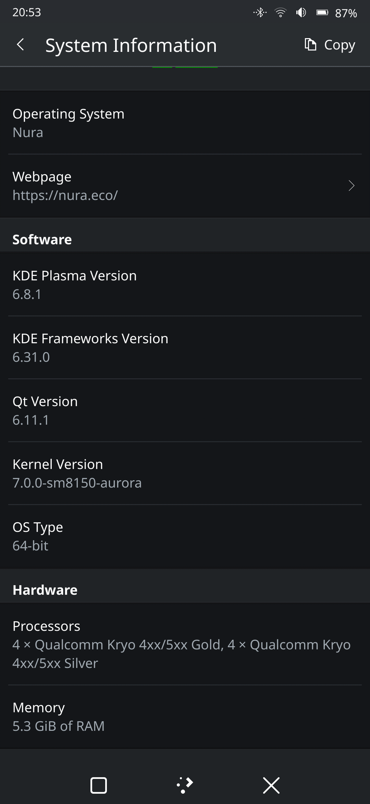
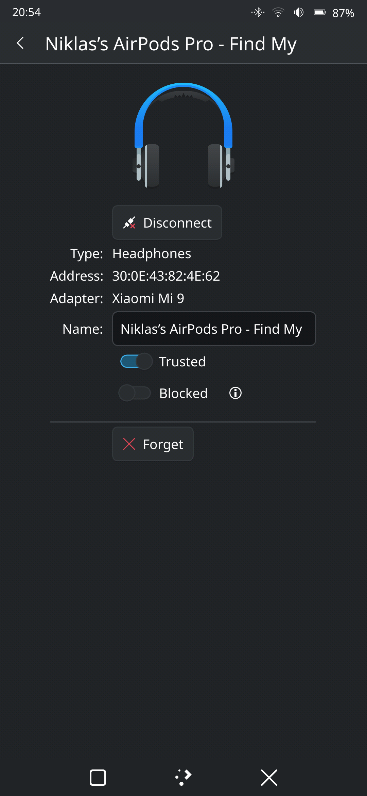

# Mainline Linux on the Xiaomi Mi 9 (cepheus)

postmarketOS edge on a **mainline kernel (`7.0.0-sm8150-aurora`)** on the Xiaomi Mi 9, with Plasma Mobile or Phosh.
Kernel and device-tree patches, pmaports changes, setup scripts for the phone, and a dev environment for macOS or Linux.
**A tech demo: it works on one phone, use at your own risk. THIS NEEDS SERIOUS CLEANUP. USE ONLY AT YOUR OWN RISK. I DID THIS BECAUSE I HAD THE PHONE LAYING AROUND AND DECIDED TO HAVE FUN!**

<table><tr>
<td></td>
<td></td>
<td></td>
</tr><tr>
<td>Plasma Mobile 6.8, kernel <code>7.0.0-sm8150-aurora</code></td>
<td>AirPods Pro paired over Bluetooth</td>
<td>YouTube in the browser, GPU-accelerated</td>
</tr></table>

## Status

| Works | Notes |
|---|---|
| Boot, UFS storage | Needed a UFS VCC fix (see [How it works](#how-it-works)) |
| Display, backlight | Samsung AMS639RQ08 (EA8076), command mode, 1080×2340@60 Hz, existing mainline driver |
| Touch | ST FTM5 on I2C (`ftm5_i2c`) |
| GPU | Adreno 640, freedreno, GLES 3.2 |
| Wi-Fi | WCN3990 (`ath10k_snoc`), real MAC from `persist` |
| Bluetooth | WCN3998 (`hci_qca`), pairs AirPods |
| Speaker | CS35L41, conservative gain (no speaker-protection DSP) |
| Battery, charging | Fuel gauge + charger, basic charging |
| Sensors, auto-rotate | Accelerometer, light, compass via the SLPI DSP |
| UI | Plasma Mobile 6.8 or Phosh 0.58 |
| USB networking | ssh at `172.16.42.1` |

**Not yet:** cellular, cameras, microphones, earpiece, proximity, fast/wireless charging. See [Known issues](#known-issues-and-todo).
How each part works: [Documentation](#documentation).

## Quick start

### 1. Host (macOS or Linux)
- **macOS:** Apple silicon, Homebrew, ~15 GB disk. pmbootstrap runs in an OrbStack VM (`pmos`, Alpine edge).
- **Linux:** install `git python3 fastboot curl make clang lld llvm dtc flex bison bc perl`, openssl + libelf headers,
  `sudo` or `doas`; optional `tinyproxy` and `netcat`. pmbootstrap runs on the host (on x86_64 it cross-compiles).
- **Linux with Docker:** only rootful Docker needed. Prefix commands with `scripts/docker-env` to run them in a
  container that has all of the above ([docs/docker.md](docs/docker.md)).

```sh
git clone <this repo> cepheus-linux && cd cepheus-linux
./setup-host.sh     # tools/VM (macOS) or tool check (Linux), pmbootstrap 3.12.1, our pmaports, kernel tree
# or, on Linux with Docker:
scripts/docker-env ./setup-host.sh
```

It applies `pmaports/cepheus.bundle` on top of current pmaports (or resets to our exact base if that conflicts) and creates
the kernel tree `~/src/linux-v7.0.0-sm8150` with all patches. The scripts call `vmsh` (in `scripts/common.sh`), which runs
build commands in the VM on macOS and on the host on Linux.

### 2. Install postmarketOS on the phone
Needs an unlocked bootloader and intact stock firmware partitions (`modem`, `vendor`, `dsp`, `bluetooth`, `persist`):
the firmware is used in place from them. **Back up `persist`, `modemst1/2`, `fsg`, `fsc` (IMEI!) and `devinfo` first**
(e.g. from a recovery: `adb exec-out dd if=/dev/block/by-name/persist > persist.img`) and keep them offline.

```sh
pmbootstrap install --password cepheus      # VM on macOS
pmbootstrap export                          # -> /tmp/postmarketOS-export (on macOS: copy it out of the VM)
# phone in fastboot (Volume Down + Power):
fastboot erase dtbo                         # mainline needs no Android DTBO
fastboot --disable-verity --disable-verification flash vbmeta vbmeta.img   # your stock vbmeta
fastboot flash userdata xiaomi-cepheus.img
fastboot flash boot boot.img
fastboot reboot
```
On a Linux host, `pmbootstrap flasher flash_rootfs` / `flash_kernel` / `flash_vbmeta` do the same. This is the standard
pmOS flow; the author's unit was installed onto a non-stock partition layout.

### 3. Set up the phone
Built packages aren't in git: download the Release assets into `apks/` (kernel 7.0.0-r8, `device-xiaomi-cepheus` 7-r1
+ `-nonfree-firmware`, `iio-sensor-proxy` 3.9-r3), or build them (see [Development](#development)). Then, phone on USB:

```sh
scripts/kde-setup.sh        # Plasma Mobile
scripts/phosh-setup.sh      # Phosh (greetd + phrog; lists Plasma too if installed)
scripts/cli-setup.sh        # console only
WIFI_SSID=MyNet WIFI_PSK=secret scripts/kde-setup.sh   # also store a Wi-Fi profile
scripts/pms reboot
```
All three run `cli-setup.sh` → `phone-setup.sh` (as root on the phone; safe to re-run, also to switch UI). They install our
packages plus hexagonrpcd, bluez and NetworkManager, put the files from `phone-config/` in place and pick the boot UI.
A fresh phone has no Wi-Fi until this has run, so the script shares the host's internet for the run
(temporary tinyproxy, USB subnet only) and sets the phone's clock if it's off.

### 4. Daily use
- `ssh user@172.16.42.1` (placeholder password `cepheus`, also for `sudo`). The host gets `172.16.42.2` by DHCP over USB.
- `scripts/pm '<cmd>'` runs as user, `scripts/pms '<cmd>'` as root, `scripts/pcp file phone:/path` copies.
- Kernel upgrades write the `boot` partition automatically (`deviceinfo_flash_kernel_on_update`).
- Fastboot: Volume Down + Power, or `sudo systemctl reboot --reboot-argument=bootloader`.

## Documentation

The details live in [`docs/`](docs/README.md), with Mermaid diagrams throughout:

| | |
|---|---|
| [Architecture](docs/architecture.md) | The whole system on one page: SoC, DSPs, kernel, userspace, and how this repo wraps pmbootstrap |
| [Hardware map](docs/hardware.md) | Every peripheral with bus, address, GPIOs, power rails; reserved memory; what isn't enabled |
| [Boot and storage](docs/boot-and-storage.md) | Boot chain, partition layout, `boot.img`, partitions you must never write |
| [Firmware and coprocessors](docs/firmware-and-coprocessors.md) | msm-firmware-loader, the four Hexagon DSPs, QRTR, tqftpserv, rmtfs |
| [Subsystems](docs/README.md#subsystems) | One page each: storage, display, GPU, touch, Wi-Fi, Bluetooth, audio, sensors, power, buttons/USB |
| [Development](docs/development.md) · [Packaging](docs/packaging.md) · [Phone setup](docs/phone-setup.md) | Working on it |
| [Troubleshooting](docs/troubleshooting.md) · [Known issues](docs/known-issues.md) | When things go wrong, and what's still broken |

## How it works

Facts came from Xiaomi's downstream kernel (`MiCode/Xiaomi_Kernel_OpenSource`, branch `cepheus-p-oss`; relevant files in
`kernel/downstream-reference/`); the DT shape from sibling mainline boards (raphael = Mi 9T Pro/K20 Pro, vayu, nabu).
All DT changes are in `sm8150-xiaomi-cepheus.dts` (full result: `kernel/sm8150-xiaomi-cepheus.dts.final`).
Stock firmware is used **in place**: msm-firmware-loader mounts `modem`/`vendor`/`dsp`/`bluetooth`/`persist` read-only
and links the blobs into `/run/msm-firmware-loader/target` ([details](docs/firmware-and-coprocessors.md)).

| Patch | What it took | Details |
|---|---|---|
| 0004 UFS | The DT let VCC (`l10a`) drop to 2.504 V, a UFS 3.0 level; this UFS 2.1 chip needs 2.95 V. Without it no cepheus with this UFS boots | [storage](docs/subsystems/storage.md) |
| 0004 Display | Command-mode panel (simplefb can't drive it); same module as raphael, so mainline's `panel-samsung-ams639rq08` works. Wiring only | [display](docs/subsystems/display.md) |
| 0005 Remoteprocs, Wi-Fi | WLAN firmware runs on the modem DSP. Board data: `board.bin` → stock `bdwlan.bin`. Real MAC from `persist`. **Don't install `linux-firmware-ath10k`** | [wifi](docs/subsystems/wifi.md) |
| 0006 GPU | `&gmu` + `&gpu` on, zap shader `a640_zap.mdt` | [gpu](docs/subsystems/gpu.md) |
| 0007 Touch | ST's downstream FTM5 driver built a second time for I2C (`ftm5_i2c`); `st,ignore-mp-flag` skips a 40 s init on every boot | [touch](docs/subsystems/touch.md) |
| 0008 Battery | `simple-battery` node; 4.4 V max is written to the charger's float-voltage register, so it must match the cell | [power](docs/subsystems/power.md) |
| 0009 Sensors | SLPI + 16 MiB FastRPC heap, a one-line fastrpc fix from LKML, and an iio-sensor-proxy fork so auto-rotate starts | [sensors](docs/subsystems/sensors.md) |
| 0010 Speaker | The machine driver never gave the CS35L41 its bit clock (PLL never locked). Gain 10, no protection DSP: **don't raise it** | [audio](docs/subsystems/audio.md) |
| 0011 Bluetooth | DT only: `qcom,wcn3998-bt` on `uart13` with pin states; `bootmac` provides the BD address | [bluetooth](docs/subsystems/bluetooth.md) |

`CONFIG_LOCALVERSION="-sm8150-aurora"` in the package config gives the kernel its name. Drop it when upstreaming.

## Development

Edit the DT, build only the DTB (seconds), boot it **from RAM**, check, then package:

```sh
$EDITOR ~/src/linux-v7.0.0-sm8150/arch/arm64/boot/dts/qcom/sm8150-xiaomi-cepheus.dts   # in the VM on macOS (orb -m pmos)
scripts/vm-build-dtb.sh     # -> images/test.dtb
scripts/test-dtb.sh         # builds a boot.img on the phone with the test DTB, fastboot-boots it (nothing flashed)
scripts/pm 'dmesg | tail'   # a normal reboot returns to the flashed image
```

Then turn the kernel commit into a `00NN-cepheus-<what>.patch` in pmaports, bump `pkgrel`, `pmbootstrap checksum` +
`build --force`, copy the `.apk` into `apks/` and `apk add --allow-untrusted` it on the phone (this flashes `boot`).
Step by step, with diagrams: [Development workflow](docs/development.md) and [Packaging](docs/packaging.md).

## Recovery and safety

Fastboot lives in the bootloader, which none of this touches: **you can always get back to fastboot** (Volume Down + Power).

- Kernel/DTB doesn't boot: `fastboot flash boot` the last good boot.img (keep a copy of `/boot/boot.img` before upgrading).
- Rootfs broken: reinstall (Quick start 2), then run a setup script.
- IMEI/EFS damaged: `dd` your offline `modemst1/2`, `fsg`, `fsc` dumps back, **only if actually needed**.
- Never commit partition dumps (`.gitignore` blocks `backup/` and `*.img`).
- `cepheus` is a placeholder password and is in `scripts/common.sh`. Change it (`passwd`, then `PHONE_PASS=…`) if that
  matters; with key login you can disable SSH password auth.

More, including a "phone doesn't come up" flowchart: [Troubleshooting](docs/troubleshooting.md).

## Known issues and TODO

1. **GPU faults at Plasma start**: a burst of `gpu fault` + one hangcheck recover in the first seconds of the session.
2. **Panel polish**: Mi-9-specific init values from the downstream panel dtsi; rounded corners clip the console.
3. **Audio**: microphones (`ADSP_EALREADY` on SLIMBUS_0_TX), earpiece (TAS2557, no mainline driver), speaker protection.
4. **Cellular**: the modem boots; needs ModemManager over QMI/qrtr and testing with a SIM.
5. **Charging**: fast charging (SMB1390, QC/PD), wireless, Xiaomi's fuel-gauge profile.
6. **Sensors**: proximity isn't exposed; if the SLPI crashes, sensors stay dead until reboot.
7. **Touch**: no suspend/wake integration; the driver also registers gesture keys.
8. **Bluetooth**: audio profiles beyond the AirPods test are untested.
9. **Variants**: the DT assumes the f1mp panel and WDC UFS. Other Mi 9 units may differ (panel `f1p2`, other UFS vendors).

Suspected causes, roadmap and what upstreaming would take: [Known issues and roadmap](docs/known-issues.md).

## Patches that were done

- pmaports: `pmaports/0001…0008-*.patch` against `device/testing/{linux-postmarketos-qcom-sm8150,device-xiaomi-cepheus}`.
- Kernel: `kernel/0004…0011`. The UFS VCC fix matters most.
- iio-sensor-proxy: `pmaports/iio-sensor-proxy-0001-*.patch`

Which kernel patch went into which pmaports commit and `pkgrel`: [Packaging](docs/packaging.md#patch-map).

## Repository layout

```
setup-host.sh          dev environment (macOS VM or Linux host)
scripts/               {cli,kde,phosh}-setup.sh + phone-setup.sh; pm/pms/pcp (ssh helpers); tn (initramfs shell);
                       vm-build-dtb.sh, test-dtb.sh, phone-mkboot.sh (DT loop); flash-boot-from-linux.sh; common.sh (settings);
                       docker-env (run any of this in the Docker build environment)
docker/                Dockerfile + entrypoint for the Linux build container
phone-config/          hand-made files installed on the phone, under their real paths
kernel/                kernel patches 0004–0011, the full resulting DTS, Xiaomi's downstream DT sources
pmaports/              our pmaports commits as a git bundle (+ BASE_COMMIT) and as patches
config/                pmbootstrap config
docs/                  architecture, hardware, per-subsystem and workflow documentation (start at docs/README.md)
docs/screenshots/      screenshots
apks/, images/         built packages / local scratch (not in git)
CLAUDE.md              brief for an AI agent continuing the work
```

## Acknowledgements

Nearly everything here stands on other people's work. Thank you:

- **[postmarketOS](https://postmarketos.org)** and its community for pmbootstrap, pmaports, the packaging and the wiki.
- **Alexey Minnekhanov (Alexey Min)**, who created the cepheus port (device package and mainline DTS) and maintains it
  ([wiki page](https://wiki.postmarketos.org/wiki/Xiaomi_Mi_9_(xiaomi-cepheus))).
- The **SM8150 mainline** effort ([#sm8150-mainline:matrix.org](https://matrix.to/#/#sm8150-mainline:matrix.org)): Pan Ortiz and
  Viola Guerrera (maintainers of `linux-postmarketos-qcom-sm8150`), and Casey Connolly, Uclydde, Arseniy Velikanov (Adomerle),
  Omnidapps and Shadowsvanish, as listed on the [SoC wiki page](https://wiki.postmarketos.org/wiki/Qualcomm_Snapdragon_855_(SM8150)).
- Authors of the sibling boards used as templates: Piyush Raj Chouhan (raphael), Degdag Mohamed, Arseniy Velikanov and
  Ali Nasrullayev (vayu), map220v (nabu, and the sm8150 sound machine driver).
- Driver authors: Danila Tikhonov (AMS639RQ08 panel), Casey Connolly, Joel Selvaraj and Yassine Oudjana (charger and fuel
  gauge), STMicroelectronics (FTM5 touch driver), and Robin Snyders and Piyush Raj Chouhan for the fastrpc sensors fix
  (reviewed by Dmitry Baryshkov).
- Userspace: Richard Acayan ([hexagonrpc](https://github.com/linux-msm/hexagonrpc)), Dylan Van Assche
  ([libssc](https://codeberg.org/DylanVanAssche/libssc), [bootmac](https://gitlab.postmarketos.org/postmarketOS/bootmac)),
  Bastien Nocera ([iio-sensor-proxy](https://gitlab.freedesktop.org/hadess/iio-sensor-proxy)), [linux-msm](https://github.com/linux-msm)
  (qrtr, tqftpserv, rmtfs) and the msm-firmware-loader contributors.
- The upstream Linux Qualcomm (arm64/qcom, freedreno, ath10k, ASoC) maintainers and contributors.
- Xiaomi, for publishing the downstream kernel sources the device facts come from.

This bring-up: Niklas, with an AI coding agent (Claude) doing much of the hands-on work.

Licence: MIT for scripts and docs; kernel patches, DTS and downstream sources are GPL-2.0 (see `LICENSE`).
