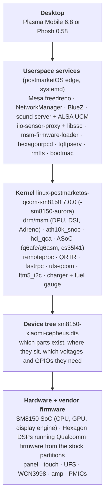
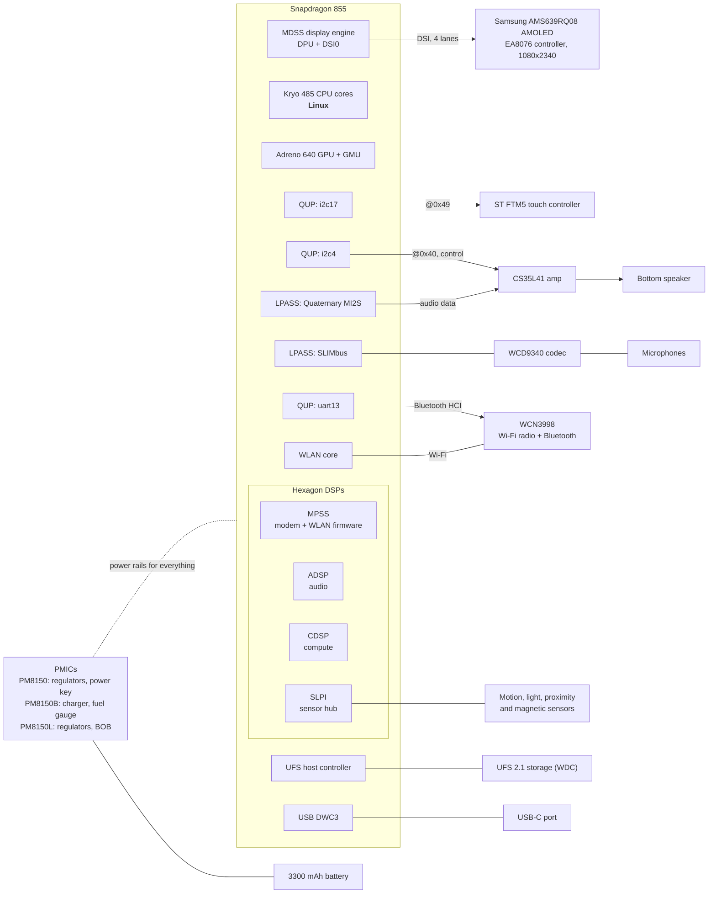
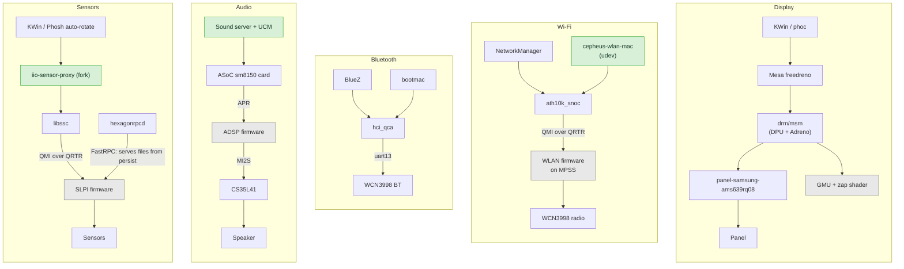
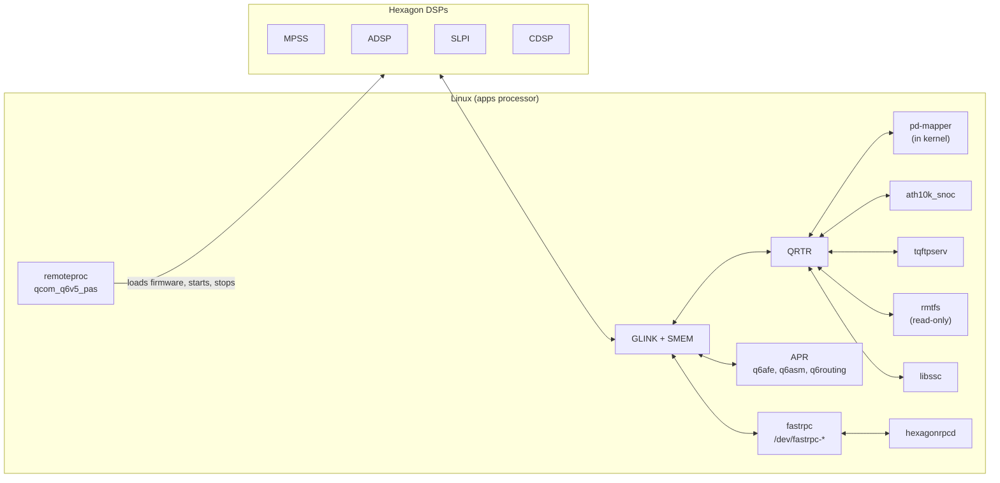
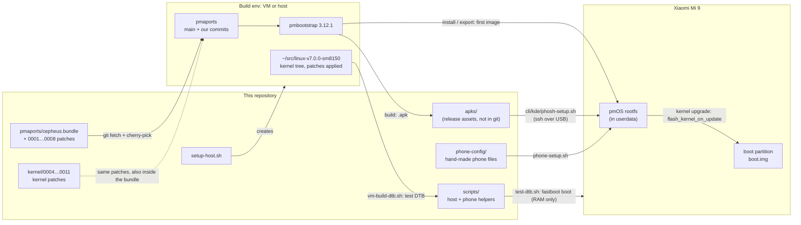

# Architecture

How a Xiaomi Mi 9 runs mainline Linux here, from silicon to the desktop, and how this repository fits around postmarketOS.
The per-subsystem pages go deeper; this page is the map.

- [The phone in one picture](#the-phone-in-one-picture)
- [The SoC and what's around it](#the-soc-and-whats-around-it)
- [Software stack](#software-stack)
- [How the processors talk to each other](#how-the-processors-talk-to-each-other)
- [Feature slices](#feature-slices)
- [How this repository fits around postmarketOS](#how-this-repository-fits-around-postmarketos)
- [Design decisions](#design-decisions)

## The phone in one picture

Five layers. Each one depends on the one below. Most bring-up bugs were at the boundary between two of them: a wrong
voltage in the device tree, a missing clock in a driver, a firmware file under the wrong name.

The device tree layer is where most of this project's work went: eight kernel patches (`kernel/0004…0011`), of which
five touch only the DTS and three also change a driver (touch, FastRPC, and the sound machine driver).

## The SoC and what's around it

The Snapdragon 855 (SM8150) is not one processor but several: the ARM cores that run Linux, plus four Hexagon DSPs that
each run their own Qualcomm firmware, plus the GPU's own management core. Linux has to start each of them with the
right firmware and then talk to them over shared memory.

The [hardware map](hardware.md) has the exact addresses, GPIOs and supply rails for each of these.

## Software stack

The stack per function, from the app at the top down to the chip. Grey boxes are firmware we don't control: it comes
from Xiaomi's stock partitions and runs on a DSP.

Green boxes are our own work in userspace (the kernel-side work is in every column). The [feature slices](#feature-slices)
table below links each column to its page.

## How the processors talk to each other

Linux and the DSPs share memory and exchange messages through a few kernel transports. Knowing which feature uses which
transport explains most of the dependencies between services.

| Transport | What travels over it here | Users |
|---|---|---|
| remoteproc | Firmware loading (`*.mdt` + segments), start/stop, crash recovery | All four DSPs |
| QRTR (IPC router) + QMI | Service discovery and control messages | `ath10k_snoc` (WLAN), `tqftpserv` (firmware files for the modem), `rmtfs` (modem EFS), libssc (sensors), pd-mapper |
| APR | Audio routing and stream commands | ASoC `q6afe`, `q6asm`, `q6routing` → ADSP |
| FastRPC | DSP calls back into Linux, e.g. to read files | `hexagonrpcd` serving the SLPI's sensor registry from `persist` |

Details: [Firmware and coprocessors](firmware-and-coprocessors.md).

## Feature slices

Each feature cuts through all layers. The page for each one has its own diagram.

| Feature | Device tree | Kernel driver | Firmware | Userspace | Page |
|---|---|---|---|---|---|
| Storage | `&ufs_mem_hc`, L10A ≥ 2.95 V | `ufs-qcom` | none | none | [storage](subsystems/storage.md) |
| Display | `&mdss_dsi0` + `panel@0` | `drm/msm`, `panel-samsung-ams639rq08` | none | KWin / phoc | [display](subsystems/display.md) |
| GPU | `&gpu`, `&gmu`, zap shader | `drm/msm` (adreno) | `a640_zap.mdt` + GPU blobs | Mesa freedreno | [gpu](subsystems/gpu.md) |
| Touch | `&i2c17` `touchscreen@49` | `ftm5_i2c` (patched) | on the touch IC | libinput | [touch](subsystems/touch.md) |
| Wi-Fi | `&wifi`, `&remoteproc_mpss` | `ath10k_snoc` | `modem.mdt`, `wlanmdsp.mbn`, `bdwlan.bin` | NetworkManager, `cepheus-wlan-mac` | [wifi](subsystems/wifi.md) |
| Bluetooth | `&uart13` `bluetooth` | `hci_qca` | `crbtfw21.tlv`, `crnv21.bin` | BlueZ, bootmac | [bluetooth](subsystems/bluetooth.md) |
| Speaker | `&sound`, `&i2c4` `cs35l41`, `&q6afedai` | ASoC `sm8150` (patched), `cs35l41` | `adsp.mdt` | UCM `HiFi.conf` | [audio](subsystems/audio.md) |
| Sensors | `&remoteproc_slpi`, FastRPC heap | `fastrpc` (patched) | `slpi_cp.mdt` | hexagonrpcd, libssc, iio-sensor-proxy (fork) | [sensors](subsystems/sensors.md) |
| Battery | `battery`, `&pm8150b_charger`, `&pm8150b_fg` | charger + fuel gauge | none | UPower | [power](subsystems/power.md) |
| Keys, USB | `gpio_keys`, `&pon_*`, `&usb_1*` | `gpio-keys`, `pm8941-pwrkey`, `dwc3` | none | none | [input-and-usb](subsystems/input-and-usb.md) |

## How this repository fits around postmarketOS

This repo is not a fork of postmarketOS. It's a set of changes plus the tooling to apply them. The real build happens in
pmbootstrap, against a pmaports checkout with our commits on top.

The two flows that matter:

1. **Iterating on hardware support:** edit the DTS in the kernel tree, build only the DTB, boot it from RAM, look at
   `dmesg` and the screen. Nothing is written to flash. See [Development workflow](development.md).
2. **Shipping a change:** turn the kernel commit into a `00NN-*.patch` in pmaports, bump `pkgrel`, build the package,
   install it on the phone. The kernel package's install hook writes `boot`. See [Packaging](packaging.md).

## Design decisions

These choices shape everything else. Each one is explained in more detail on the page it links to.

| Decision | Why | Consequence |
|---|---|---|
| Use firmware **in place** from the stock partitions, mounted read-only ([firmware](firmware-and-coprocessors.md)) | Qualcomm firmware is signed per OEM and can't be redistributed. The phone already has the right versions. | Stock `modem`, `vendor`, `dsp`, `bluetooth` and `persist` must be intact. DT firmware names are bare (`modem.mdt`). |
| **Sibling mainline boards as templates**, downstream DT as ground truth ([development](development.md#where-the-facts-come-from)) | raphael (Mi 9T Pro) uses the same panel and Wi-Fi/BT supplies, and its DT already follows mainline conventions. Xiaomi's downstream DT has the real voltages and GPIOs. | Most nodes are copied from raphael, then corrected against `kernel/downstream-reference/`. |
| **No new kernel drivers where an existing one fits** | Less code to maintain or upstream. | The panel reuses `panel-samsung-ams639rq08`. Touch reuses ST's downstream FTM5 driver, built a second time for I2C. |
| **Test from RAM, flash only what boots** ([development](development.md#the-dt-loop)) | `fastboot boot` never writes `boot`, so a bad DTB costs a reboot, not a recovery. | `scripts/test-dtb.sh` builds the test image on the phone so the kernel and initramfs match exactly. |
| **Conservative speaker gain** ([audio](subsystems/audio.md)) | Xiaomi protects the speaker with DSP firmware and per-unit calibration. We don't run either. | Analog gain is 10 (Xiaomi uses 17 with protection). Don't raise it. |
| **The Wi-Fi MAC comes from `persist`, the BT address from `bootmac`** ([wifi](subsystems/wifi.md), [bluetooth](subsystems/bluetooth.md)) | ath10k picks a random MAC each boot. The BT chip has no address of its own. | A udev helper sets the real Wi-Fi MAC. bootmac's Wi-Fi rule is masked so it doesn't overwrite it. |
