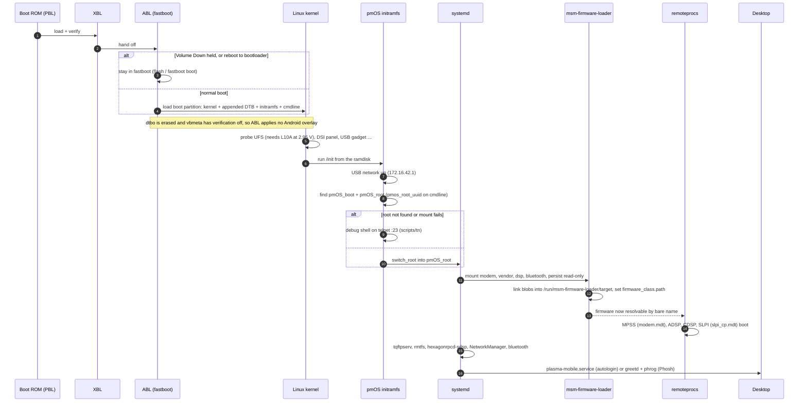
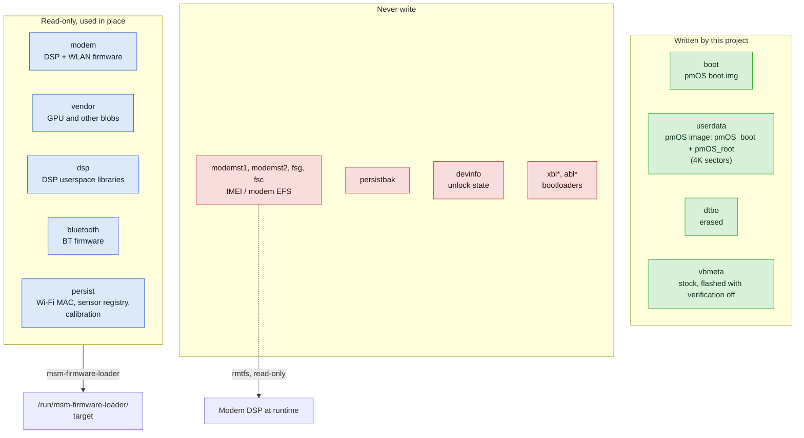
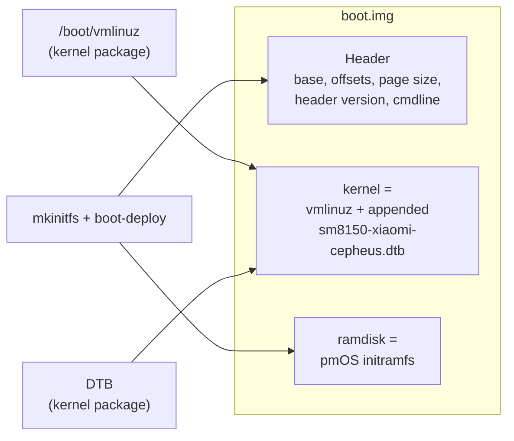
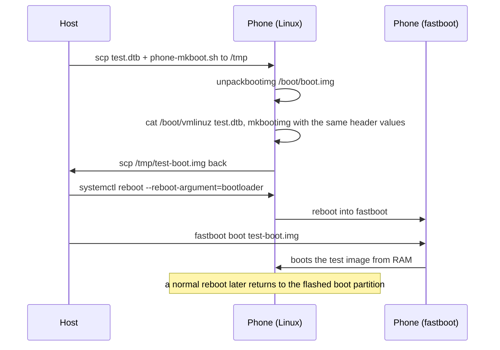

# Boot and storage

What happens between pressing Power and seeing Plasma, which partitions are involved, and which ones you must never
write.

- [Boot chain](#boot-chain)
- [Partition layout](#partition-layout)
- [What's in boot.img](#whats-in-bootimg)
- [Kernel upgrades write boot automatically](#kernel-upgrades-write-boot-automatically)
- [Testing from RAM](#testing-from-ram)
- [Partition safety rules](#partition-safety-rules)

## Boot chain

Everything up to and including ABL is Qualcomm/Xiaomi code that this project never touches. That's why fastboot is
always reachable (Volume Down + Power), whatever state Linux is in.



Where each step can fail and how to tell:

| Step | Failure looks like | First thing to check |
|---|---|---|
| ABL → kernel | Stuck on the Mi logo, no USB network at all | Last flashed `boot.img`. Reflash the previous one from fastboot |
| Kernel → UFS | Ping works, ssh doesn't; initramfs can't find root | `scripts/tn 'dmesg \| grep -i ufs'`: `link startup failed` means the `l10a` VCC level (see [storage](subsystems/storage.md)) |
| Initramfs | Ping works, ssh doesn't | `scripts/tn 'tail -40 /pmOS_init.log'` |
| systemd | Emergency mode: root locked, no ssh | A non-root mount without `nofail`. Hold Power ~10 s to power off |
| Firmware | Wi-Fi/sensors/audio missing, rest fine | `ls /run/msm-firmware-loader/target`, `dmesg \| grep -i remoteproc` |

More in [Troubleshooting](troubleshooting.md).

## Partition layout

The stock Android layout stays in place. postmarketOS lives inside `userdata` (the author's unit uses a non-stock
layout, but the standard install below is what the README describes).



| Partition | Role here | Written? |
|---|---|---|
| `boot` | pmOS `boot.img` | Yes: at install and on every kernel package upgrade |
| `userdata` | pmOS image: `pmOS_boot` (kernel, initramfs, `boot.img` copy) + `pmOS_root` | Yes: at install |
| `dtbo` | Android DT overlays. Mainline doesn't want them | Erased once at install |
| `vbmeta` | Verified boot metadata | Flashed once with `--disable-verity --disable-verification` |
| `modem`, `vendor`, `dsp`, `bluetooth` | Firmware source | **No**, read-only mounts |
| `persist` | Per-unit data: `wlan_mac.bin`, sensor registry, calibration | **No**, read-only mount. Back it up offline |
| `modemst1/2`, `fsg`, `fsc` | Modem EFS, IMEI | **Never**. Back them up offline |
| `devinfo`, `abl*`, `xbl*`, `persistbak` | Bootloader state and code | **Never** |

## What's in boot.img



- `deviceinfo_append_dtb=true`: the DTB is concatenated onto the kernel image, which is how ABL on this phone finds it.
- The cmdline carries `pmos_root_uuid=…`, which the initramfs uses to find the root partition.
  `scripts/phone-mkboot.sh` can swap it via `ROOT_UUID=` to boot a different root.
- The header values (base, offsets, page size, header version) are copied from the installed `/boot/boot.img` when we
  build a test image, so a test image differs from the real one only in its DTB.

## Kernel upgrades write boot automatically

`device-xiaomi-cepheus` sets `deviceinfo_flash_kernel_on_update="true"` (pmaports patch 0001). So:


Side effect: **any** `apk add` that triggers mkinitfs re-flashes `boot` from the installed kernel. If you're in the
middle of testing a DTB from RAM, the next reboot goes back to the installed DTB, not yours.

There's also `scripts/flash-boot-from-linux.sh boot.img` to write an arbitrary image from running Linux with a
checksum check. Normally you don't need it.

## Testing from RAM

`fastboot boot` loads an image into RAM and runs it once without writing anything. A failed test costs one reboot.



That's `scripts/test-dtb.sh` (it calls `scripts/phone-mkboot.sh` on the phone). Building the image on the phone
guarantees the kernel and initramfs match the installed modules.

## Partition safety rules

Before any `dd` to a partition, check its name:

```sh
scripts/pms 'findfs PARTLABEL=boot'                     # -> /dev/sdXN
scripts/pms 'grep PARTNAME /sys/class/block/sdXN/uevent' # double-check a device node
scripts/pm  'findmnt /'                                  # never mkfs/dd what this shows
```

Back up before you start, from a recovery, and keep the images offline (never in git; `.gitignore` blocks `backup/`
and `*.img`):

```sh
for p in persist modemst1 modemst2 fsg fsc devinfo; do
  adb exec-out dd if=/dev/block/by-name/$p > $p.img
done
```

If the IMEI/EFS is ever damaged, `dd` the offline `modemst1/2`, `fsg`, `fsc` dumps back, and only if you actually need to.
