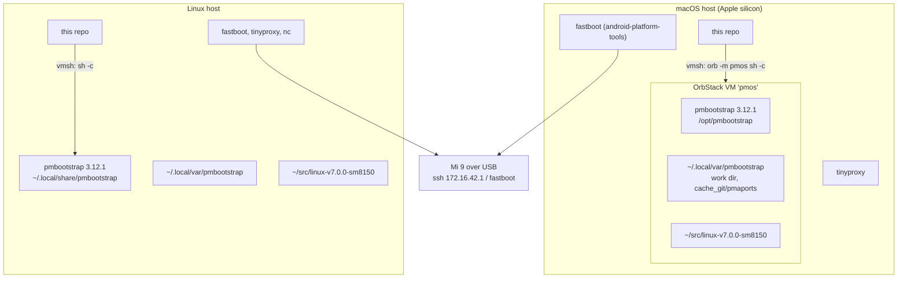
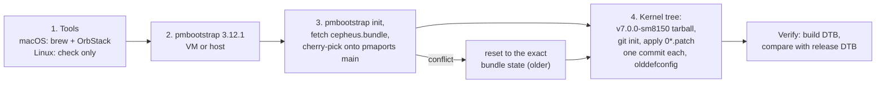
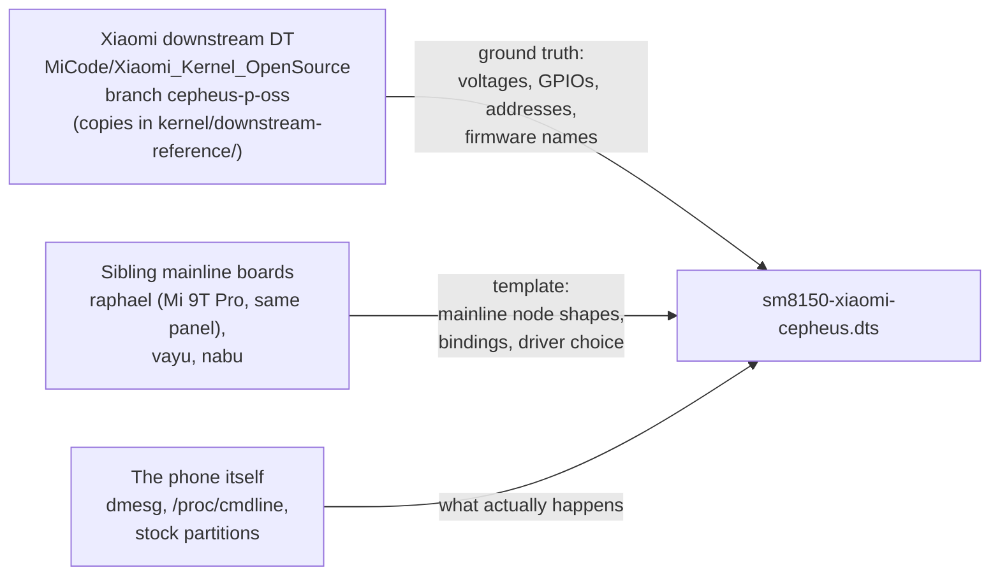
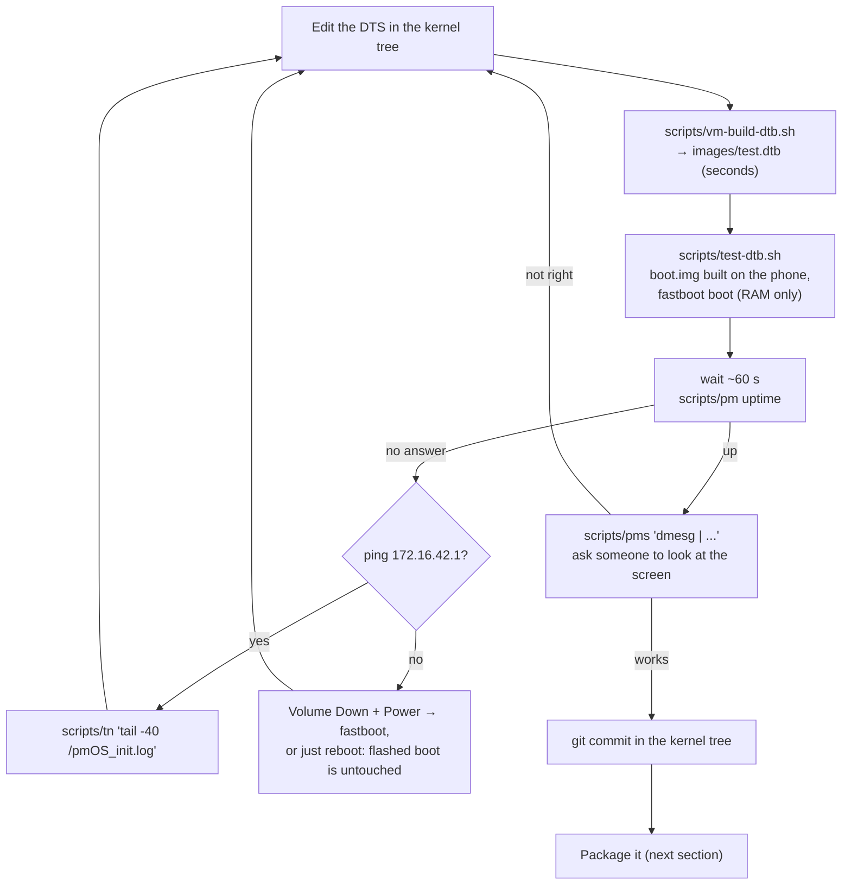
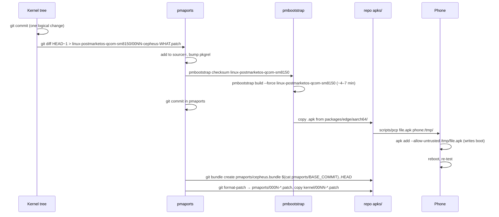

# Development workflow

How to change something and get it onto the phone safely. If you only want to install, the
[README quick start](../README.md#quick-start) is enough.

- [Environment](#environment)
- [Where the facts come from](#where-the-facts-come-from)
- [The DT loop](#the-dt-loop)
- [Packaging a change](#packaging-a-change)
- [Kernel builds](#kernel-builds)
- [Testing a single module](#testing-a-single-module)
- [Conventions](#conventions)

## Environment

`setup-host.sh` creates everything. On macOS, pmbootstrap needs a Linux VM. On Linux, it runs on the host. The scripts
hide the difference behind `vmsh` (in `scripts/common.sh`).



What `setup-host.sh` does, in order (idempotent, 10–20 min):



| Thing | Path (VM on macOS, host on Linux) |
|---|---|
| pmbootstrap work dir | `~/.local/var/pmbootstrap` |
| pmaports (main + our commits) | `~/.local/var/pmbootstrap/cache_git/pmaports` |
| Kernel package | `…/pmaports/device/testing/linux-postmarketos-qcom-sm8150/` |
| Device package | `…/pmaports/device/testing/device-xiaomi-cepheus/` |
| Built packages | `~/.local/var/pmbootstrap/packages/edge/aarch64/` |
| Kernel tree | `~/src/linux-v7.0.0-sm8150` (git: `base` + one commit per patch) |
| The DTS | `~/src/linux-v7.0.0-sm8150/arch/arm64/boot/dts/qcom/sm8150-xiaomi-cepheus.dts` |

Settings live in `scripts/common.sh` and can be overridden from the environment: `PHONE_IP` (172.16.42.1),
`PHONE_USER` (user), `PHONE_PASS` (cepheus), `VM` (pmos).

## Where the facts come from



Rule of thumb: take the **shape** from raphael and the **numbers** from downstream. When the two disagree, downstream wins
(UFS VCC is the example: mainline's value was wrong for this phone).

## The DT loop

Seconds per iteration, nothing flashed.



```sh
$EDITOR ~/src/linux-v7.0.0-sm8150/arch/arm64/boot/dts/qcom/sm8150-xiaomi-cepheus.dts   # in the VM on macOS (orb -m pmos)
scripts/vm-build-dtb.sh     # -> images/test.dtb
scripts/test-dtb.sh         # builds a boot.img on the phone with the test DTB, fastboot-boots it
scripts/pm 'dmesg | tail'   # a normal reboot returns to the flashed image
```

If you're working over ssh, you can't see the screen. At each step that changes the display, have someone look at the
phone or send a screenshot.

## Packaging a change



After every pmaports commit, refresh the bundle (and the patch copies) so `setup-host.sh` on a new machine reproduces
your state:

```sh
cd ~/.local/var/pmbootstrap/cache_git/pmaports
git bundle create /path/to/repo/pmaports/cepheus.bundle $(cat /path/to/repo/pmaports/BASE_COMMIT)..HEAD
```

Details of the package structure and the patch ↔ `pkgrel` mapping are in [Packaging](packaging.md).

## Kernel builds

- Full package build: about 7 min on 17 cores, about 4 min warm.
- The package builds with **`LLVM=1`**. Build DTBs and modules in the tree with `LLVM=1` too, or you'll compare different
  toolchains' output.
- On x86_64 Linux hosts pmbootstrap cross-compiles. On Apple silicon the VM is native aarch64.
- The kernel's local version is `-sm8150-aurora` (`CONFIG_LOCALVERSION` in the package config, pmaports patch 0008).
  Drop it when upstreaming.

## Testing a single module

Faster than a package build when you're iterating on one driver: build the module in the kernel tree (with `LLVM=1`),
copy it over, and load it by hand.

```sh
# Only if the running kernel is an older build than the tree: strip BTF, or loading fails with "BTF: -22"
vmsh 'llvm-objcopy --remove-section=.BTF path/to/module.ko'
scripts/pcp path/to/module.ko phone:/tmp/ && scripts/pms 'insmod /tmp/module.ko'
```

The module's version magic still has to match the running kernel's release string.

## Conventions

- **One kernel patch per feature**, numbered `00NN-cepheus-<what>.patch`, applied in order on top of the package's own
  `0001`–`0003`. The DTS ends up as `kernel/sm8150-xiaomi-cepheus.dts.final`. Keep that copy in sync.
- **Comments in the DTS say where a value came from** (`/* downstream cepheus-sm8150.dtsi: … */`). Keep doing that.
- **Phone-side files** go in `phone-config/` under their real path *and* get an install line in `scripts/phone-setup.sh`.
  Keep the two in sync.
- Commits in the build environment without a git identity: `git -c user.name=… -c user.email=… commit`.
- Background jobs over ssh die with the session: `systemd-run --unit=x --collect sh -c '…'` on the phone, `setsid nohup`
  in the VM.
- `/tmp` on the phone is tmpfs: test images there disappear on reboot.
