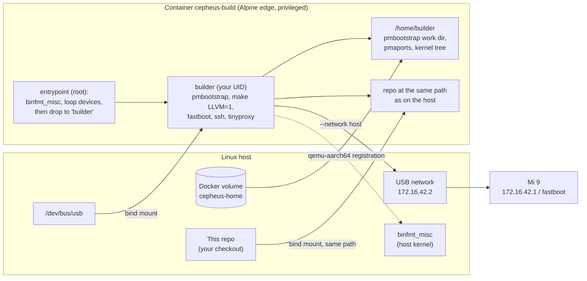

# Docker build environment (Linux)

Everything the [development workflow](development.md) needs, in one container: pmbootstrap, the kernel tree, the
LLVM toolchain for DTBs and modules, plus fastboot, ssh and tinyproxy for talking to the phone. Nothing gets installed
on the host except Docker. It plays the same role on Linux that the OrbStack VM plays on macOS.

```sh
scripts/docker-env ./setup-host.sh     # once: pmbootstrap, pmaports with our commits, kernel tree (10–20 min)
scripts/docker-env                      # a shell; everything from the README and docs works in there
```

Tested on an x86_64 host (Docker 29): `setup-host.sh` completes in the container, including the DTB build, and
`pmbootstrap build device-xiaomi-cepheus` produces `linux-postmarketos-qcom-sm8150-7.0.0-r8` (`7.0.0-sm8150-aurora`,
with `ftm5_i2c` and the cepheus DTB) and `device-xiaomi-cepheus-7-r1`. The phone-facing parts (fastboot, ssh over USB)
haven't been tested from the container yet.

## How it's put together



| Piece | Why |
|---|---|
| `docker/Dockerfile` | Alpine edge, the same base as the macOS VM. All tools `setup-host.sh` checks for, plus fastboot (`android-tools`), ssh, tinyproxy, nc |
| User `builder` with your UID/GID, passwordless `doas` | pmbootstrap refuses to run as root but needs root for chroots. Files it writes into `apks/` and `images/` stay yours |
| Repo mounted **at the same path** | `scripts/*` compute paths from their own location. Same path inside and out means nothing needs translating |
| Named volume `cepheus-home` → `/home/builder` | pmbootstrap's work dir (`~/.local/var/pmbootstrap`), pmaports, `~/src/linux-v7.0.0-sm8150` and the pmbootstrap config survive `--rm` |
| `--privileged` | pmbootstrap mounts `proc`/`dev` into its chroots, registers qemu with `binfmt_misc` and uses loop devices for `pmbootstrap install` |
| `--network host` | The phone's USB network and the temporary tinyproxy in `cli-setup.sh` live on host interfaces |
| `/dev/bus/usb` bind mount | `/dev` in a container is a snapshot. fastboot needs to see the phone after it reboots into the bootloader and re-enumerates |

Inside the container `uname -s` is `Linux`, so `vmsh` in `scripts/common.sh` runs commands directly, exactly as on a
Linux host.

## Usage

```sh
scripts/docker-env                                   # interactive shell, starts in your current directory
scripts/docker-env ./setup-host.sh                   # first time
scripts/docker-env scripts/vm-build-dtb.sh           # -> images/test.dtb
scripts/docker-env scripts/test-dtb.sh               # RAM-boot it (fastboot from inside the container)
scripts/docker-env pmbootstrap build --force linux-postmarketos-qcom-sm8150
scripts/docker-env scripts/kde-setup.sh              # set up the phone
scripts/docker-env --rebuild                         # rebuild the image, e.g. after editing docker/
```

The first run builds the image (a couple of minutes). It's rebuilt automatically when the repo owner's UID/GID doesn't
match the image.

Built packages land in the volume at `~/.local/var/pmbootstrap/packages/edge/aarch64/`. Copy them into `apks/` from
inside the container, the same as on a normal host. That makes them visible on the host too.

| Variable | Default | Meaning |
|---|---|---|
| `CEPHEUS_IMAGE` | `cepheus-build` | Image name |
| `CEPHEUS_VOLUME` | `cepheus-home` | Volume for `/home/builder` |
| `CEPHEUS_DOCKER_ARGS` | | Extra `docker run` arguments, e.g. `-v $HOME/.ssh:/home/builder/.ssh:ro` for key login to the phone |
| `PHONE_*`, `WIFI_SSID`, `WIFI_PSK` | | Passed through to the scripts (see `scripts/common.sh`) |
| `http(s)_proxy`, `no_proxy` | | Passed through |

## Things to know

- **Rootful Docker.** Rootless Docker and Podman can't register binfmt handlers or create loop devices, so aarch64
  package builds and `pmbootstrap install` fail there.
- **binfmt_misc belongs to the host kernel.** The qemu-aarch64 handler that pmbootstrap registers stays active on the
  host after the container exits (until reboot, or `pmbootstrap shutdown`). On an aarch64 host none of this is needed.
- **x86_64 hosts cross-compile.** pmbootstrap builds the kernel package "cross-native" (cross toolchain in the x86_64
  chroot): about 1.5 h on 4 cores the first time, much less with more cores and a warm ccache. Other packages
  (`device-xiaomi-cepheus`, `iio-sensor-proxy`) build "crossdirect" in an aarch64 chroot under qemu.
- **pmbootstrap builds outdated dependencies first.** `pmbootstrap build device-xiaomi-cepheus` on a fresh volume also
  builds the kernel, because the device package depends on it.
- **One container at a time.** Two containers sharing the volume would run two pmbootstraps on one work dir.
- **The volume is the state.** `docker volume rm cepheus-home` wipes pmbootstrap, pmaports (including any uncommitted
  work there!) and the kernel tree. Refresh `pmaports/cepheus.bundle` before you do that.
- **Phone access from the host still works.** `scripts/pm`, `pms`, `pcp`, `tn` and fastboot only need ssh/nc/fastboot,
  so you can run them on the host and use the container only for building. `vm-build-dtb.sh` needs the kernel tree, so
  run it in the container.
