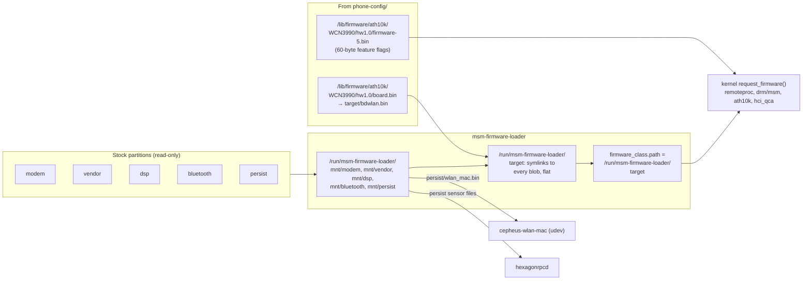
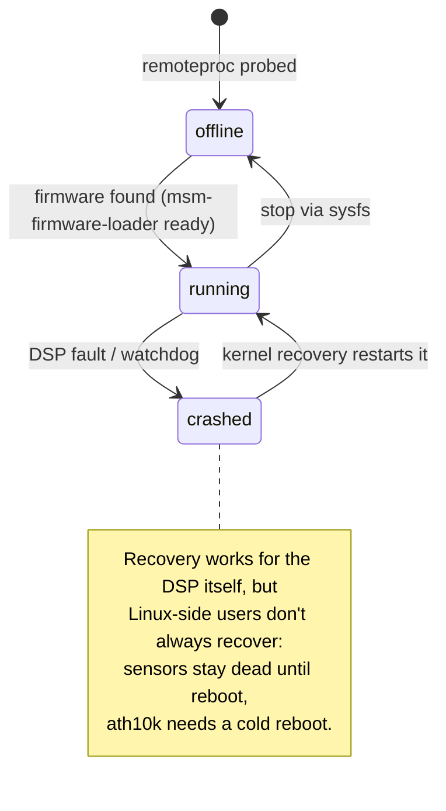
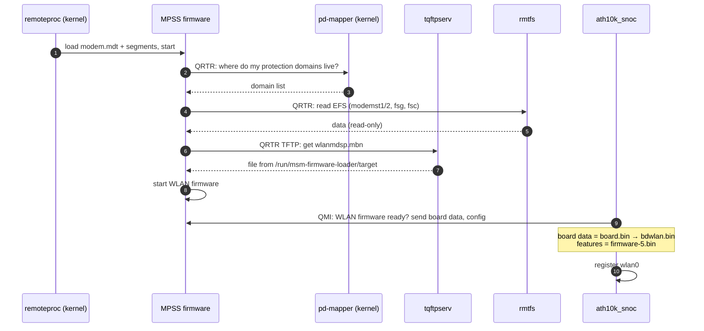
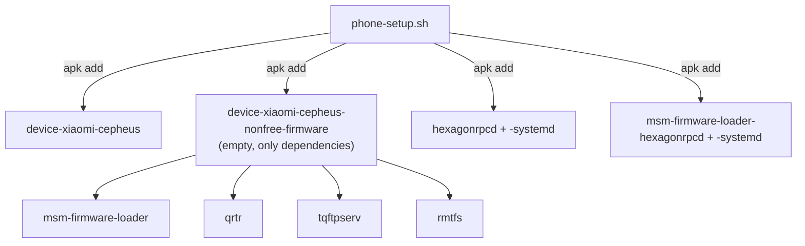

# Firmware and coprocessors

Half of what the Mi 9 does runs on Qualcomm firmware, not in Linux. This page covers where that firmware comes from, how
Linux starts the DSPs, and the services that talk to them.

- [Where firmware comes from](#where-firmware-comes-from)
- [The four DSPs](#the-four-dsps)
- [The modem DSP and its helpers](#the-modem-dsp-and-its-helpers)
- [Firmware files by consumer](#firmware-files-by-consumer)
- [Packages involved](#packages-involved)
- [Checking it](#checking-it)
- [Gotchas](#gotchas)

## Where firmware comes from

Qualcomm firmware is signed per OEM, so we can't ship our own and wouldn't want to redistribute Xiaomi's. The phone
already carries the right versions in its stock partitions. **msm-firmware-loader** mounts those partitions read-only
at boot and exposes their blobs in one flat directory that the kernel searches.



Because the firmware sits in one flat directory, every DT firmware name is **bare**: `modem.mdt`, not
`qcom/sm8150/xiaomi/cepheus/modem.mdt` as an upstream device would use with packaged firmware.

## The four DSPs

SM8150 has four Hexagon DSP subsystems. In mainline each one is a `remoteproc` handled by `qcom_q6v5_pas` (Peripheral
Authentication Service: TrustZone verifies the signature before the DSP may run).

| DSP | DT node | Firmware | What it does here | Linux-side partner |
|---|---|---|---|---|
| MPSS (modem) | `&remoteproc_mpss` | `modem.mdt` | Cellular (unused) **and the WLAN firmware** | `ath10k_snoc`, tqftpserv, rmtfs, pd-mapper |
| ADSP (audio) | `&remoteproc_adsp` | `adsp.mdt` | Audio routing, MI2S/SLIMbus ports, mixing | ASoC `q6afe`/`q6asm`/`q6routing` over APR |
| CDSP (compute) | `&remoteproc_cdsp` | `cdsp.mdt` | Nothing user-visible yet | none |
| SLPI (sensor hub) | `&remoteproc_slpi` | `slpi_cp.mdt` | Reads all sensors, runs sensor fusion | libssc (QMI), hexagonrpcd (FastRPC) |

`slpi_cp` is Xiaomi's name, from the downstream `qcom,msm-ssc-sensors` node. The other three are the standard names.



## The modem DSP and its helpers

Wi-Fi depends on the modem DSP, which surprises people. The WLAN firmware (`wlanmdsp.mbn`) runs on MPSS, and the modem
fetches it from Linux at runtime.



The order of the middle steps is simplified; what matters is that all four helpers must be up before Wi-Fi appears.

| Helper | Role | Package |
|---|---|---|
| QRTR | Qualcomm IPC router: addresses services on any processor. Kernel transport + `qrtr` tools | `qrtr` |
| pd-mapper | Answers "which protection domain runs which service". In-kernel in this kernel | (kernel) |
| tqftpserv | TFTP server over QRTR. Hands files like `wlanmdsp.mbn` to the modem | `tqftpserv` |
| rmtfs | Remote filesystem: serves the modem's EFS partitions. Runs read-only here | `rmtfs` |

All three userspace helpers come in via `device-xiaomi-cepheus-nonfree-firmware`.

## Firmware files by consumer

| Consumer | Files | Source |
|---|---|---|
| MPSS | `modem.mdt` (+ `.bNN` segments), `wlanmdsp.mbn` | Stock partitions via msm-firmware-loader |
| ADSP / CDSP | `adsp.mdt`, `cdsp.mdt` | Stock partitions |
| SLPI | `slpi_cp.mdt`; sensor registry and config read at runtime | Stock partitions; `persist` via hexagonrpcd |
| GPU | `a640_zap.mdt` (zap shader, set in DT) + the other A640 blobs by bare name | Stock `vendor` |
| Wi-Fi | `board.bin` → `bdwlan.bin` (calibration); `firmware-5.bin` (feature flags) | Stock `modem` partition (`bdwlan.bin`); `phone-config/` (`firmware-5.bin`, copied from linux-firmware) |
| Bluetooth | `qca/crbtfw21.tlv`, `qca/crnv21.bin` | Stock `bluetooth` partition |
| Touch | none: the FTM5 IC keeps its own firmware (`st,disable-auto-fw-update`) | |

## Packages involved



The `nonfree-firmware` subpackage contains no files. It exists so that installing it pulls in everything needed to use the
stock firmware in place (pmaports patch 0002).

## Checking it

```sh
# State and firmware of every DSP
scripts/pm 'for r in /sys/class/remoteproc/*; do echo "$(cat $r/name) $(cat $r/state) $(cat $r/firmware)"; done'

# What msm-firmware-loader found
scripts/pm 'ls /run/msm-firmware-loader/target | head -50'
scripts/pm 'findmnt | grep msm-firmware-loader'

# Firmware load errors
scripts/pms 'dmesg | grep -iE "remoteproc|firmware|qcom_q6v5"'
```

## Gotchas

- **A cold reboot is the reliable reset.** Restarting the modem by hand, or reloading `ath10k` after the WLAN firmware is
  up, fails. Power-cycle instead.
- **Don't install `linux-firmware-ath10k`.** Its `board-2.bin` has a generic entry for `board_id 0xff`, which ath10k
  prefers over `board.bin`. The Mi 9 calibration gets replaced silently and Wi-Fi works badly or not at all.
  See [Wi-Fi](subsystems/wifi.md).
- **The SLPI can crash.** If it does, sensors stay dead until reboot even though remoteproc restarts the DSP.
- **Never let anything write `persist` or the EFS partitions.** msm-firmware-loader mounts read-only and rmtfs runs
  read-only. Keep it that way.
