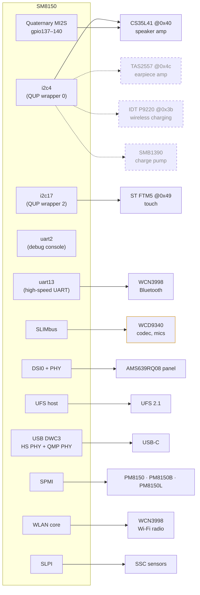
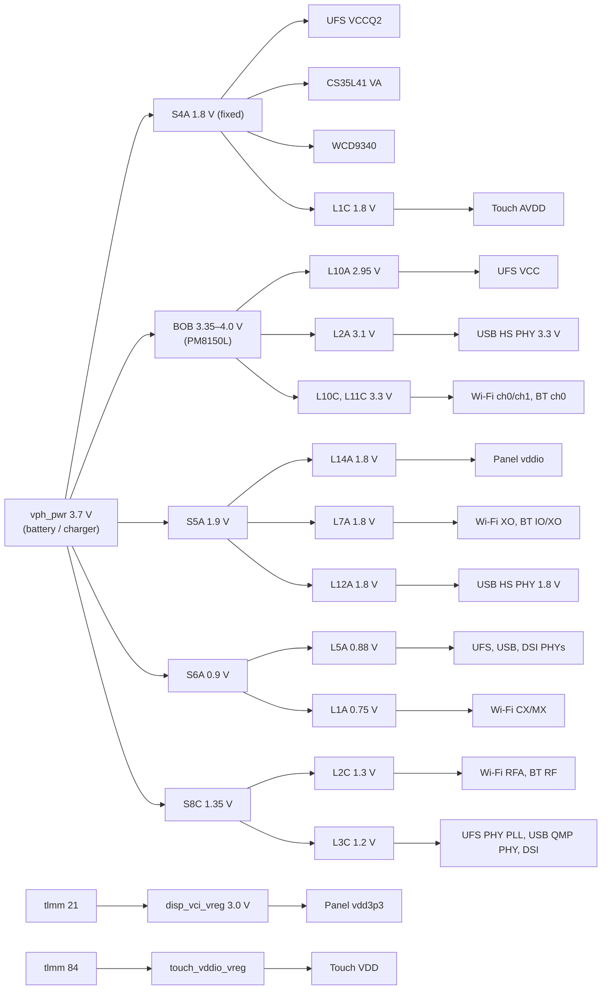

# Hardware map

Everything the device tree (`kernel/sm8150-xiaomi-cepheus.dts.final`) tells the kernel about the Mi 9, organised by
bus, plus the parts that aren't enabled yet. Facts come from Xiaomi's downstream DT (`kernel/downstream-reference/`)
unless marked otherwise.

- [Overview](#overview)
- [Buses and peripherals](#buses-and-peripherals)
- [GPIOs](#gpios)
- [Power rails](#power-rails)
- [Reserved memory](#reserved-memory)
- [Not enabled](#not-enabled)
- [Unit variants](#unit-variants)

## Overview

| | |
|---|---|
| Model | Xiaomi Mi 9, codename `cepheus`, DT compatible `"xiaomi,cepheus", "qcom,sm8150"` |
| SoC | Qualcomm Snapdragon 855 (SM8150) |
| GPU | Adreno 640 |
| Storage | UFS 2.1, on the author's unit WDC (`ufsid=0x145`) |
| Display | 6.39-inch Samsung AMOLED, module AMS639RQ08, controller EA8076, 1080×2340 @ 60 Hz, DSI **command mode**, 4 lanes |
| Touch | ST FTM5 on I2C |
| Wi-Fi / BT | SM8150 WLAN core + WCN3998 companion chip (radio, Bluetooth) |
| Audio | CS35L41 speaker amp, WCD9340 codec (mics), TAS2557 earpiece amp. No headphone jack |
| Battery | 3300 mAh, 3.4–4.4 V |
| PMICs | PM8150 (A), PM8150B (B), PM8150L (C) |

## Buses and peripherals

Dashed: on the board (per the downstream DT), not described in our DT. Orange: described, not working yet (mic capture).

| Device | Bus / address | Interrupt | Reset / enable | Supplies | Driver | Patch |
|---|---|---|---|---|---|---|
| UFS 2.1 | UFS host | | tlmm 175 | VCC `l10a` 2.95–2.96 V, VCCQ2 `s4a` 1.8 V; PHY `l5a`, `l3c` | `ufs-qcom` | 0004 |
| Panel AMS639RQ08 | DSI0, VC 0, 4 lanes | TE tlmm 8 (`mdp_vsync`) | reset tlmm 6 | vddio `l14a` 1.8 V, vdd3p3 `disp_vci_vreg` (tlmm 21, 3.0 V); DSI `l3c`, PHY `l5a` | `panel-samsung-ams639rq08` | 0004 |
| Adreno 640 + GMU | MMIO | | | (SoC rails) | `drm/msm` | 0006 |
| ST FTM5 touch | `i2c17` @0x49, 400 kHz | tlmm 122, level low | tlmm 12 | vdd `touch_vddio_vreg` (tlmm 84), avdd `l1c` 1.8 V | `ftm5_i2c` | 0007 |
| CS35L41 amp | `i2c4` @0x40, 400 kHz; audio on Quaternary MI2S | tlmm 10, level low | tlmm 89 | VA `s4a` 1.8 V; boost 4 A peak, 1 µH, 15 µF | `cs35l41` (ASoC) | 0010 |
| WCD9340 codec | SLIMbus | | tlmm 143 | `s4a` 1.8 V (all) | `wcd934x` | 0010 |
| WCN3998 Bluetooth | `uart13`, max 3.2 Mbaud | | | vddio/vddxo `l7a` 1.8 V, vddrf `l2c` 1.3 V, vddch0 `l11c` 3.3 V | `hci_qca` | 0011 |
| Wi-Fi (WLAN core) | SNOC | | | cx-mx `l1a` 0.75 V, xo `l7a`, rfa `l2c`, ch0 `l11c`, ch1 `l10c` 3.3 V | `ath10k_snoc` | 0005 |
| Charger | PM8150B (SPMI) | | | | charger driver (`qcom_smbx`) | 0008 |
| Fuel gauge | PM8150B (SPMI) | | | | fuel-gauge driver | 0008 |
| Power key | PM8150 PON | | | | `pm8941-pwrkey` | base DT |
| Volume down | PM8150 PON (RESIN) | | | | `pm8941-pwrkey` | base DT |
| Volume up | PM8150 GPIO 6 | | | | `gpio-keys` | base DT |
| "AI" key | tlmm 97 → `KEY_HOMEPAGE` | | | | `gpio-keys` | base DT |
| USB | DWC3, peripheral only, high-speed | | | HS PHY `l5a`/`l12a`/`l2a`; QMP PHY `l3c`/`l5a` | `dwc3-qcom` | base DT |
| Debug UART | `uart2`, 115200n8 (`serial0`) | | | | `qcom_geni_serial` | base DT |

"Base DT" means it was already in the cepheus DTS (Alexey Minnekhanov's port) before this project.

## GPIOs

SoC TLMM pins the DT uses, in pin order:

| Pin | Function | Notes |
|---|---|---|
| 0–3 | NFC SPI | `gpio-reserved-ranges`: protected by the secure world, Linux must not touch them |
| 6 | Panel reset | active low |
| 8 | Panel TE (`mdp_vsync`) | command-mode panel signals when it's safe to send a frame |
| 10 | CS35L41 IRQ | pull-up |
| 12 | Touch reset | shares `ts_active` pinctrl with 122 |
| 21 | Panel VCI enable | fixed regulator `disp_vci_vreg`, 3.0 V |
| 43–46 | `uart13` CTS, RTS, TX, RX | Bluetooth. Default and sleep states copied from downstream `qupv3_se13_4uart` (sm8150.dtsi has none) |
| 84 | Touch vddio enable | fixed regulator `touch_vddio_vreg`, 4 ms startup |
| 89 | CS35L41 reset | |
| 97 | "AI" button | mapped to `KEY_HOMEPAGE` (Linux has no AI key) |
| 122 | Touch IRQ | level low |
| 126–129 | Fingerprint SPI | `gpio-reserved-ranges` |
| 137, 138 | Quaternary MI2S SCK, WS | |
| 139, 140 | Quaternary MI2S SD0, SD1 | SD0 = speaker data |
| 143 | WCD9340 reset | |
| 175 | UFS reset | active low |

PMIC GPIOs: PM8150 GPIO 6 = volume up. PM8150B GPIO 5 = enable for `vdd_boost_vreg` (always on).

> **Note:** the `vdd_boost_vreg` pinctrl configures PM8150B **GPIO 12**, but the regulator itself switches **GPIO 5**
> (as downstream does). This predates this project and is untested. Worth checking before relying on that rail.

## Power rails

The PMICs' regulators are controlled through RPMh (the SoC's resource manager), not directly. The DT only declares
which voltages each rail may take. The regulator core then picks the **lowest voltage all consumers agree on**. This
detail broke UFS (see [storage](subsystems/storage.md)).

Rails that matter most when something doesn't power up:

| Rail | Voltage range in DT | Consumers | Gotcha |
|---|---|---|---|
| `l10a` | 2.950–2.960 V | UFS VCC | Was 2.504 V minimum, a UFS 3.0 level. UFS 2.1 won't link up. **Patch 0004.** |
| `s4a` | 1.8 V fixed | UFS VCCQ2, CS35L41, WCD9340, L1C (PM8150L L1/L8 parent) | Modelled as `regulator-fixed`, as in vendor sources |
| `l14a` | 1.8 V | Panel vddio | |
| `l7a` | 1.8 V | Wi-Fi XO, BT vddio + vddxo | Shared by Wi-Fi and BT |
| `l2c` | 1.304 V | Wi-Fi RFA, BT RF | Shared |
| `l11c` | 3.0–3.312 V | Wi-Fi ch0, BT ch0 | Shared |
| `l1c` | 1.8 V | Touch AVDD | |
| `bob` | 3.35–4.0 V, auto mode | Parent of most high-voltage LDOs | |

## Reserved memory

Memory carved out for firmware and the secure world. Cepheus differs from the generic `sm8150.dtsi` layout (larger TZ
and ADSP regions shift everything after them), so the DTS deletes the inherited nodes and redefines them. Getting these
wrong crashes a DSP or the whole phone as soon as the firmware touches memory Linux has already handed out.

| Region | Start | Size | Used by |
|---|---|---|---|
| `tz_mem` | `0x86200000` | 85 MiB | TrustZone |
| `adsp_mem` | `0x8be00000` | 34 MiB | ADSP firmware |
| `mpss_mem` | `0x8e000000` | 150 MiB | Modem firmware |
| `venus_mem` | `0x97600000` | 5 MiB | Video codec (not enabled) |
| `slpi_mem` | `0x97b00000` | 20 MiB | SLPI firmware |
| `ipa_fw_mem` | `0x98f00000` | 64 KiB | IPA (modem data path) |
| `ipa_gsi_mem` | `0x98f10000` | 20 KiB | IPA |
| `gpu_mem` | `0x98f15000` | 8 KiB | GPU zap shader |
| `spss_mem` | `0x99000000` | 1 MiB | Secure processor |
| `cdsp_mem` | `0x99100000` | 20 MiB | CDSP firmware |
| `cont_splash_mem` | `0x9c000000` | 36 MiB | Bootloader framebuffer (`simple-framebuffer` points here) |
| `cdsp_sec_mem` | `0xa4c00000` | 60 MiB | CDSP secure heap |
| ramoops | `0xb0000000` | 4 MiB | Kernel log across warm reboots (pstore) |
| `rmtfs_mem` | `0xf4101000` | 3 MiB | Modem EFS shared buffer, with 4 KiB guard pages either side (downstream "XPU limitation") |
| `fastrpc_mem` | dynamic (below 4 GiB) | 16 MiB | SLPI FastRPC heap, reusable CMA. **Patch 0009.** |

## Not enabled

On the board according to the downstream DT, but not described in ours (or described but not working):

| Part | Downstream location | Why it's not done |
|---|---|---|
| Cellular | MPSS already boots (it runs the WLAN firmware) | Needs ModemManager over QMI/QRTR and testing with a SIM |
| Microphones | WCD9340 on SLIMbus, ADC1/ADC3 | ADSP rejects `SLIMBUS_0_TX` with `ADSP_EALREADY`. See [audio](subsystems/audio.md) |
| Earpiece | TAS2557 on `i2c4` @0x4c, IRQ tlmm 60 | No mainline driver |
| Speaker protection | CS35L41 DSP firmware + calibration | Not in mainline flow. Hence the low gain |
| Fast charging | SMB1390 charge pump on `i2c4`; QC/PD | No driver/DT yet |
| Wireless charging | IDT P9220 on `i2c4` @0x3b, IRQ tlmm 90, enable tlmm 104 | No driver |
| Haptics | PM8150B haptics | Not described |
| Proximity | Behind the SLPI | libssc / iio-sensor-proxy don't expose it yet |
| Cameras | `cepheus-sm8150-camera-sensor-mtp.dtsi` (not in this repo) | Not started |
| Fingerprint | Goodix, reset tlmm 37, IRQ tlmm 120, power tlmm 125, SPI 126–129 | No mainline driver, secure-world SPI |
| NFC | SPI on tlmm 0–3 | Secure-world SPI |
| IR blaster | `ir-spi` on QUP SE1 SPI | Not described |
| Video codec | Venus | Not enabled |
| USB-C audio switch | FSA4480 | Disabled downstream as well |
| USB 3 / host mode | DWC3 is `dr_mode = "peripheral"`, high-speed only | Matches downstream; host mode not tried |

## Unit variants

The DT assumes **the author's unit**: panel `f1mp` and WDC UFS. Xiaomi shipped other combinations:

- Panel: downstream lists `dsi_samsung_fhd_ea8076_f1mp_cmd`, `…_f1p2_cmd` and `…_f1p2_2_cmd`. Only `f1mp` has been
  tested. The bootloader passes the panel name on its command line, so `cat /proc/cmdline` on your unit tells you which
  one you have.
- UFS: other vendors may need different VCC levels. If `dmesg` shows `link startup failed`, look at `l10a` first.
- Battery: downstream ships fuel-gauge profiles for ATL and Coslight 3300 mAh cells (selected by battery ID).
  The charger's downstream `fv-max-uv` is 4.4 V for both, and that's what we program.
