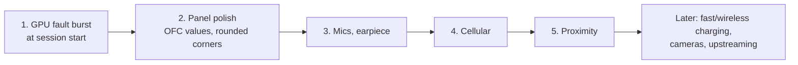

# Known issues and roadmap

What doesn't work, what we suspect, and the order we plan to take things on. Each item links to the page with the
details.

## Roadmap

## Status by area

Green works, yellow works with caveats, red doesn't work or isn't started.

## Issues

| # | Area | Issue | Suspected cause / next step | Page |
|---|---|---|---|---|
| 1 | GPU | Burst of `gpu fault` + one `hangcheck recover` in the first seconds of a Plasma session, none afterwards | UBWC / highest-bank-bit configuration for A640. Try `FD_MESA_DEBUG=noubwc` | [gpu](subsystems/gpu.md) |
| 2 | Display | Mi-9-specific `E9` OFC values and `D9`/`C0` blocks from the downstream panel dtsi aren't sent; rounded corners clip the console | Port the extra init commands; give the compositor corner/cut-out information | [display](subsystems/display.md) |
| 3 | Audio | Microphones: `AFE enable … ADSP_EALREADY` on `SLIMBUS_0_TX` | SLIMbus port / WCD9340 channel setup ordering | [audio](subsystems/audio.md) |
| 3 | Audio | Earpiece: TAS2557 has no mainline driver | Write or port a driver | [audio](subsystems/audio.md) |
| 3 | Audio | Speaker protection not running, so gain is capped at 10 | CS35L41 DSP firmware + calibration | [audio](subsystems/audio.md) |
| 4 | Cellular | Modem boots (it runs the WLAN firmware) but nothing uses it | ModemManager over QMI/QRTR, test with a SIM | [firmware](firmware-and-coprocessors.md) |
| 5 | Sensors | Proximity isn't exposed | libssc / iio-sensor-proxy support | [sensors](subsystems/sensors.md) |
| 5 | Sensors | After an SLPI crash, sensors stay dead until reboot | Userspace reconnect after remoteproc recovery | [sensors](subsystems/sensors.md) |
| 6 | Charging | No fast charging (SMB1390, QC/PD), no wireless (IDT P9220), no Xiaomi fuel-gauge profile; battery temperature limits read −30 °C (cosmetic) | Drivers / DT for SMB1390 and P9220 | [power](subsystems/power.md) |
| 7 | Touch | No suspend/wake integration; driver registers gesture keys nobody uses | | [touch](subsystems/touch.md) |
| 8 | Bluetooth | Audio profiles beyond the AirPods test untested | Test HFP, other devices | [bluetooth](subsystems/bluetooth.md) |
| 9 | Variants | The DT assumes panel `f1mp` and WDC UFS | Test on other units (panel `f1p2`, other UFS vendors) | [hardware](hardware.md#unit-variants) |
| 10 | Hygiene | Placeholder password `cepheus` is in `scripts/common.sh` | Change it on the phone (`passwd`) and set `PHONE_PASS`; or use key login and disable password auth | [phone setup](phone-setup.md) |

## Upstreaming

What would have to happen for this to stop being a tech demo:

| Change | Where it should go | Notes |
|---|---|---|
| UFS VCC fix (0004) | Mainline DTS / pmaports | The most important one: without it no cepheus with this UFS boots |
| Display, remoteprocs, GPU, battery, BT, sensors DT (0004–0011) | Mainline DTS via the sm8150 tree | Mostly standard nodes |
| fastrpc sensors-PD fix (0009) | Mainline (already on LKML) | One line |
| sm8150 machine driver sysclk (0010) | Mainline ASoC | Small, generic |
| FTM5 I2C build (0007) | sm8150 kernel fork | Downstream driver, not mainline material as-is |
| iio-sensor-proxy startup fix | iio-sensor-proxy upstream | Then drop the `temp/` fork |
| `board.bin` + `firmware-5.bin` | pmaports firmware package, or a `board-2.bin` entry in ath10k-firmware: `bus=snoc,qmi-board-id=ff,qmi-chip-id=30224,variant=xiaomi_cepheus` | Replaces the hand-installed files |
| `cepheus-wlan-mac`, mount matrix rule, UCM | `device-xiaomi-cepheus`; UCM to alsa-ucm-conf | Replaces `phone-config/` |
| `-sm8150-aurora` local version | Drop it | |
