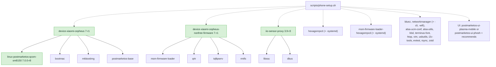
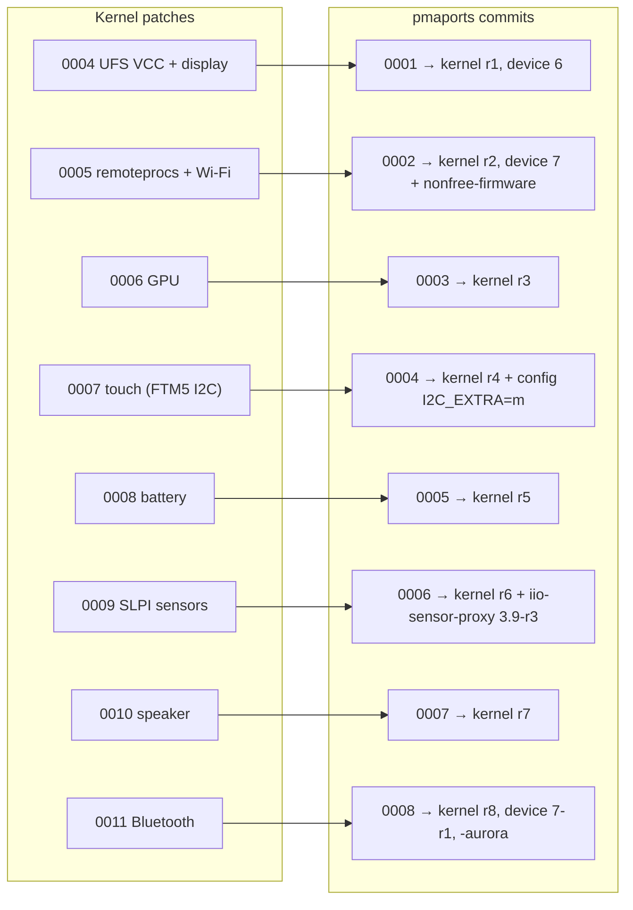
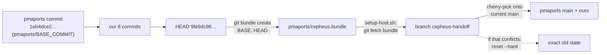

# Packaging

Everything we ship is a normal postmarketOS/Alpine package, built by pmbootstrap from pmaports. This page explains which
packages we change, how the patches are organised, and how versions move.

- [Packages](#packages)
- [Dependency graph](#dependency-graph)
- [Patch map](#patch-map)
- [How the pmaports changes are distributed](#how-the-pmaports-changes-are-distributed)
- [Release assets](#release-assets)

## Packages

| Package | pmaports path | Current | What we changed |
|---|---|---|---|
| `linux-postmarketos-qcom-sm8150` | `device/testing/linux-postmarketos-qcom-sm8150` | **7.0.0-r8** | Kernel patches 0004–0011, `CONFIG_..._I2C_EXTRA=m`, local version `-sm8150-aurora` |
| `device-xiaomi-cepheus` | `device/testing/device-xiaomi-cepheus` | **7-r1** | `flash_kernel_on_update`, depends on `bootmac`, masks bootmac's Wi-Fi rule |
| `device-xiaomi-cepheus-nonfree-firmware` | (subpackage of the above) | **7-r1** | New: pulls in msm-firmware-loader, qrtr, tqftpserv, rmtfs |
| `iio-sensor-proxy` (+ `-systemd`, `-udev`, …) | `temp/iio-sensor-proxy` | **3.9-r3** | Fork of Alpine's, with the startup fix. Must stay above Alpine's r2 |

## Dependency graph

What ends up on the phone and why. Solid arrows are package dependencies; dashed are what `phone-setup.sh` installs on
top.



`iio-sensor-proxy` is built with `-Dssc-support=enabled` (hence `libssc-dev` at build time).

## Patch map

Each feature is one kernel patch, carried into pmaports by one pmaports commit that also bumps `pkgrel`. The
`pmaports/000N-*.patch` files are `git format-patch` output of those commits; `kernel/00NN-*.patch` are the kernel
patches inside them.



| Kernel patch | Touches | pmaports commit | Kernel | Device | Other |
|---|---|---|---|---|---|
| `0004-cepheus-ufs-vcc-and-display` | DTS | `0001` | r1 | 6-r0: `deviceinfo_flash_kernel_on_update="true"` | |
| `0005-cepheus-remoteprocs-wifi` | DTS | `0002` | r2 | 7-r0: `nonfree-firmware` subpackage | |
| `0006-cepheus-gpu` | DTS | `0003` | r3 | | |
| `0007-cepheus-touchscreen-ftm5-i2c` | DTS, `fts_touch/` | `0004` | r4 | | kernel config `CONFIG_TOUCHSCREEN_STM_FTS_DOWNSTREAM_I2C_EXTRA=m` |
| `0008-cepheus-battery` | DTS | `0005` | r5 | | |
| `0009-cepheus-slpi-sensors` | DTS, `drivers/misc/fastrpc.c` | `0006` | r6 | | `temp/iio-sensor-proxy` 3.9-r3 |
| `0010-cepheus-audio-speaker` | DTS, `sound/soc/qcom/sm8150.c` | `0007` | r7 | | |
| `0011-cepheus-bluetooth` | DTS | `0008` | r8 | 7-r1: depends on `bootmac`, `90-bootmac-wifi.rules` | `CONFIG_LOCALVERSION="-sm8150-aurora"` |

The kernel package's own `0001-enable-ufs.patch`, `0002-libbpf-Fix-UAF-in-strset__add_str.patch` and
`0003-xiaomi-vayu-fix-otg.patch` are upstream pmaports, not ours. That's why our numbering starts at 0004.

## How the pmaports changes are distributed



- The bundle contains only our commits, so it needs `BASE_COMMIT` in the target repo. `setup-host.sh` unshallows the
  pmaports clone if needed.
- The cherry-pick keeps you on current upstream. If upstream changed the same files (most likely the kernel APKBUILD),
  it falls back to the exact old state and warns. Then rebase by hand.
- The `.patch` copies in `pmaports/` and `kernel/` are for reading and for upstreaming. The bundle is what setup uses.

## Release assets

Built `.apk` files aren't in git (`apks/*.apk` is ignored). They're published as GitHub Release assets;
`apks/SHA256SUMS` lists them, including older builds kept for rollback (kernel r6, r7; device 7-r0).

```sh
cd apks && sha256sum -c SHA256SUMS --ignore-missing
```

`cli-setup.sh` copies only the newest build of each package to the phone.

Installing on the phone uses `apk add --allow-untrusted` because these aren't signed with a key the phone trusts.
