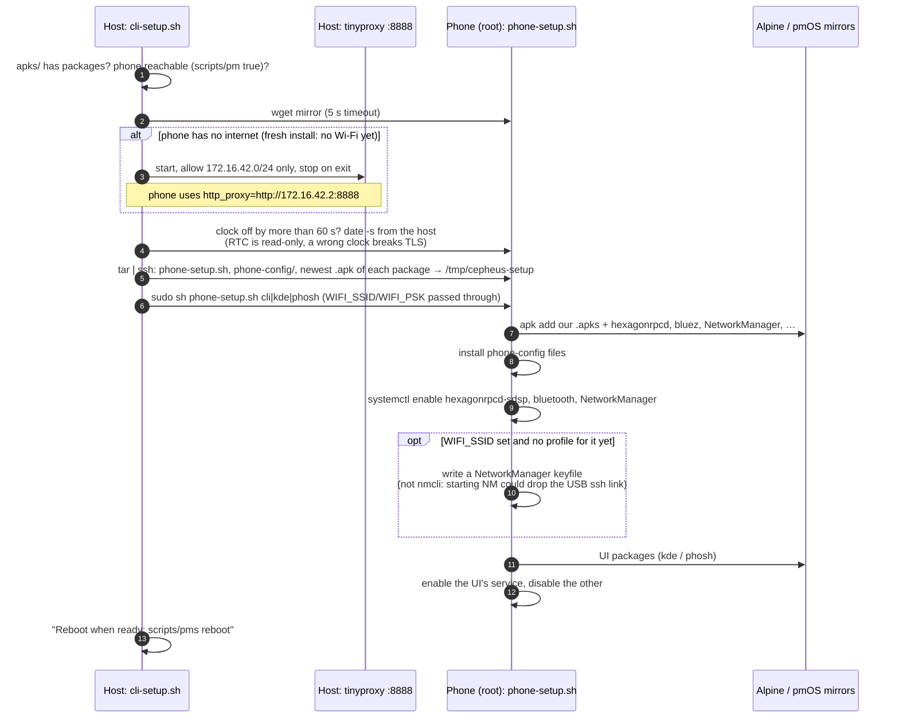
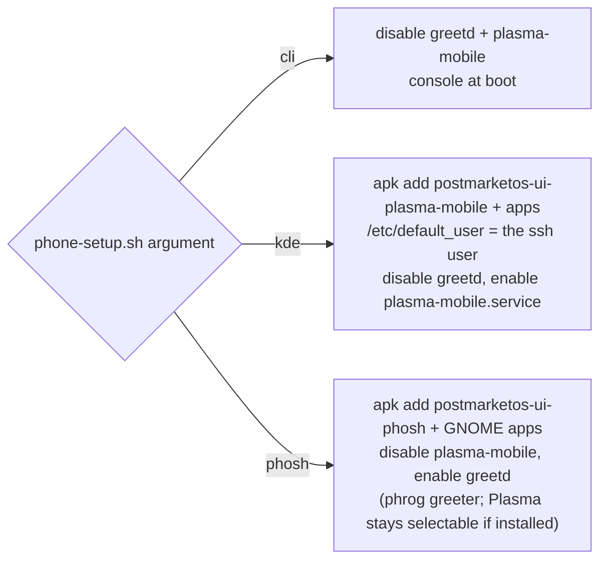
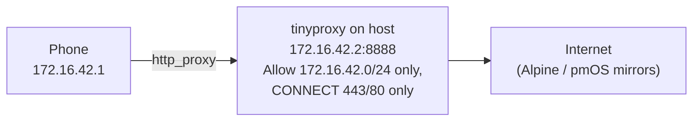

# Phone setup

What `scripts/cli-setup.sh`, `kde-setup.sh` and `phosh-setup.sh` do to a freshly installed phone, and every file they put
in place. All three are safe to re-run, which is also how you switch the boot UI.

## Overview

## Choosing the UI

| Script | Calls | Boot UI |
|---|---|---|
| `scripts/cli-setup.sh` | `phone-setup.sh cli` | Console (Terminus 16×32 bold font) |
| `scripts/kde-setup.sh` | `cli-setup.sh kde` | Plasma Mobile, autologin as `user` |
| `scripts/phosh-setup.sh` | `cli-setup.sh phosh` | Phosh via greetd + phrog |

Add `WIFI_SSID=… WIFI_PSK=…` in front of any of them to store a Wi-Fi profile that connects after the reboot.

## Files put on the phone

Everything lives in `phone-config/` under its real path.

| File | Purpose | Details |
|---|---|---|
| `/lib/firmware/ath10k/WCN3990/hw1.0/firmware-5.bin` | ath10k feature flags (copied from linux-firmware) | [wifi](subsystems/wifi.md#board-data-calibration) |
| `/lib/firmware/ath10k/WCN3990/hw1.0/board.bin` | Symlink to `/run/msm-firmware-loader/target/bdwlan.bin` (target in `board.bin.SYMLINK_TARGET`) | [wifi](subsystems/wifi.md#board-data-calibration) |
| `/usr/local/sbin/cepheus-wlan-mac` | Sets the real Wi-Fi MAC from `persist/wlan_mac.bin` | [wifi](subsystems/wifi.md#mac-address) |
| `/etc/udev/rules.d/80-cepheus-wlan-mac.rules` | Runs it when an ath10k `wlan*` appears | [wifi](subsystems/wifi.md#mac-address) |
| `/etc/NetworkManager/conf.d/50-cepheus-wifi-mac.conf` | NetworkManager keeps that MAC, no scan randomisation | [wifi](subsystems/wifi.md#mac-address) |
| `/etc/udev/rules.d/81-libssc-xiaomi-cepheus.rules` | Accelerometer mount matrix (X, Y inverted) | [sensors](subsystems/sensors.md#mount-matrix) |
| `/usr/share/alsa/ucm2/conf.d/sm8150/Xiaomi Mi 9.conf` | UCM entry point for the card named "Xiaomi Mi 9" | [audio](subsystems/audio.md#ucm) |
| `/usr/share/alsa/ucm2/Xiaomi/cepheus/HiFi.conf` | Speaker routing and gain | [audio](subsystems/audio.md#ucm) |
| `/etc/vconsole.conf` | `FONT=ter-v32b`: readable console on a 1080×2340 panel | |
| `/etc/default_user` | Default user for the Plasma Mobile session (`kde` only; written from `SUDO_USER`, not copied) | |
| `/etc/udev/rules.d/90-bootmac-wifi.rules` | Reference copy only: the **device package** installs it | [bluetooth](subsystems/bluetooth.md#bd-address) |

The script also removes `/etc/systemd/network/10-cepheus-wlan-mac.link`, the old hard-coded MAC approach.

## Adding a phone-side file

1. Put it in `phone-config/` at its real path.
2. Add an `install` line to `scripts/phone-setup.sh`.
3. If it's something every cepheus user needs, consider moving it into `device-xiaomi-cepheus` instead. That's where it
   belongs long-term, and it's how `90-bootmac-wifi.rules` ended up there.

## Internet for a fresh phone

The phone gets Wi-Fi only after this setup has installed the firmware glue, but the setup needs internet to install
packages. The way out:

The proxy runs only while `cli-setup.sh` runs (it's killed by an `EXIT` trap). Install `tinyproxy` on the host for this.
