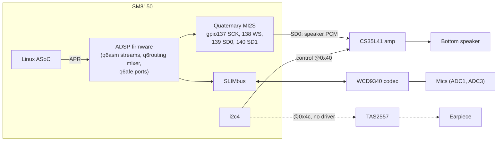

# Audio

**Status:** the bottom speaker works (mono, conservative gain). Microphones and earpiece don't.
**Patch:** `kernel/0010-cepheus-audio-speaker.patch` (pmaports 0007), plus the UCM files in `phone-config/`.

> **Don't raise the speaker's analog gain.** Xiaomi drives this speaker with the CS35L41's speaker-protection DSP
> firmware and per-unit calibration. We run neither, so nothing stops the amp from overheating the speaker. UCM sets
> analog gain 10; Xiaomi uses 17 *with* protection.

## Audio hardware



## Playback path (what works)


## What was wrong

With the DT wiring in place (machine driver, DAI links, amp node, following downstream and the vayu board, which has
the same Xiaomi SM8150 audio design), the amp still stayed silent: its PLL never locked.

The CS35L41 derives its internal clock from the I2S bit clock (SCLK), and the codec driver needs to be told that rate.
The sm8150 machine driver set the rate on the CPU side but never told the codec. Patch 0010 adds this to
`sound/soc/qcom/sm8150.c` for the Quaternary MI2S case:

```c
/* Codecs clocked from SCLK (e.g. CS35L41 PLL) need the rate; ignored by others */
snd_soc_dai_set_sysclk(codec_dai, 0, 3072000, SND_SOC_CLOCK_IN);
snd_soc_component_set_sysclk(codec_dai->component, 0, 0, 3072000, SND_SOC_CLOCK_IN);
```

3.072 MHz = 48 kHz × 32 bits × 2 channels.

## Device tree

```dts
&sound {
    compatible = "qcom,sm8150-sndcard";
    model = "Xiaomi Mi 9";
    pinctrl-0 = <&quat_mi2s_active &quat_mi2s_sd0_active &quat_mi2s_sd1_active>;

    mm1-dai-link   { cpu { sound-dai = <&q6asmdai MSM_FRONTEND_DAI_MULTIMEDIA1>; }; };
    mm2-dai-link   { cpu { sound-dai = <&q6asmdai MSM_FRONTEND_DAI_MULTIMEDIA2>; }; };
    speaker-dai-link {
        cpu   { sound-dai = <&q6afedai QUATERNARY_MI2S_RX>; };
        codec { sound-dai = <&cs35l41 0>; };
    };
    slimcap-dai-link {                       /* mics: present but not working */
        cpu   { sound-dai = <&q6afedai SLIMBUS_0_TX>; };
        codec { sound-dai = <&wcd9340 1>; };  /* AIF1_CAP */
    };
};

&i2c4 {
    cs35l41: audio-codec@40 {
        compatible = "cirrus,cs35l41";
        reg = <0x40>;
        interrupts = <10 IRQ_TYPE_LEVEL_LOW>;
        reset-gpios = <&tlmm 89 GPIO_ACTIVE_HIGH>;
        VA-supply = <&vreg_s4a_1p8>;
        cirrus,boost-peak-milliamp = <4000>;
        cirrus,boost-ind-nanohenry = <1000>;
        cirrus,boost-cap-microfarad = <15>;
        cirrus,gpio2-src-select = <4>;
        cirrus,gpio2-output-enable;
    };
};
```

The boost values are from downstream (`cepheus-sm8150.dtsi`). The patch also enables `&qupv3_id_0` (the QUP wrapper
that contains `i2c4`) and describes the WCD9340 (reset tlmm 143, all supplies `s4a`, mic bias 2.7 V, MBHC thresholds).

## UCM

```
phone-config/usr/share/alsa/ucm2/conf.d/sm8150/Xiaomi Mi 9.conf   -> HiFi use case
phone-config/usr/share/alsa/ucm2/Xiaomi/cepheus/HiFi.conf
```

| Control | Value | Why |
|---|---|---|
| `QUAT_MI2S_RX Audio Mixer MultiMedia1` | 1 | Route the MultiMedia1 stream to the speaker port |
| `PCM Source` | `ASP` | Amp plays from its serial port, not the DSP |
| `Digital PCM Volume` | 817 | 0 dB |
| `Analog PCM Volume` | 10 | Moderate. **Don't raise** without speaker protection |

Mono, one device (`Speaker`), playback priority 200. No capture device: the mics don't work yet.

## Check it

```sh
scripts/pm  'aplay -l'
scripts/pms 'dmesg | grep -iE "cs35l41|q6afe|q6asm|sm8150-snd|wcd934"'
scripts/pm  'alsaucm -c hw:0 list _verbs'     # card number from aplay -l
```

## Open issues

| Problem | Symptom | Likely direction |
|---|---|---|
| Microphones | `AFE enable … ADSP_EALREADY` on `SLIMBUS_0_TX` | The ADSP thinks the port is already in use. Look at how the SLIMbus port and WCD9340 channel setup are sequenced |
| Earpiece | TAS2557 on `i2c4` @0x4c | No mainline driver. Needs one, or a port of the downstream driver |
| Speaker protection | Gain capped at 10 | CS35L41 DSP firmware + Xiaomi calibration through the driver's DSP (`wm_adsp`) support, if feasible |
| Bluetooth audio | AirPods tested only | See [bluetooth](bluetooth.md) |
