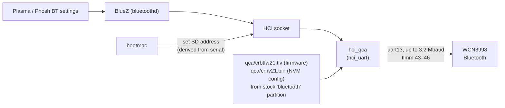
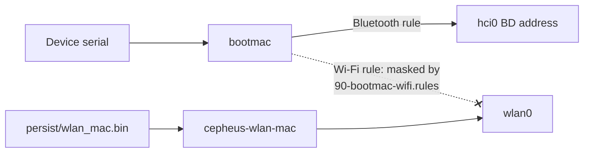

# Bluetooth (WCN3998)

**Status:** works, pairs AirPods Pro. Other audio profiles untested. **Patch:** `kernel/0011-cepheus-bluetooth.patch`
(pmaports 0008, which also adds `bootmac` and the kernel's `-sm8150-aurora` suffix).

Kernel config and firmware were already there. Only the device tree was missing.

## Data path



## Device tree

```dts
aliases {
    bluetooth0 = &bluetooth;
    hsuart0 = &uart13;
};

&uart13 {
    pinctrl-0 = <&qup_uart13_default>;
    pinctrl-1 = <&qup_uart13_sleep>;
    pinctrl-names = "default", "sleep";
    status = "okay";

    /* WCN3998, same as raphael; downstream bt_wcn3990 supplies: core l7a, pa l2c, ldo l11c */
    bluetooth: bluetooth {
        compatible = "qcom,wcn3998-bt";
        vddio-supply = <&vreg_l7a_1p8>;
        vddxo-supply = <&vreg_l7a_1p8>;
        vddrf-supply = <&vreg_l2c_1p3>;
        vddch0-supply = <&vreg_l11c_3p3>;
        max-speed = <3200000>;
    };
};
```

`sm8150.dtsi` defines no pin states for `uart13`, so the patch adds them, copied from downstream `qupv3_se13_4uart`:

| Pin | Signal | Default state | Sleep state |
|---|---|---|---|
| gpio43 | CTS | `qup13`, no pull | GPIO, pull-down |
| gpio44 | RTS | `qup13`, pull-down | GPIO, pull-down |
| gpio45 | TX | `qup13`, pull-up | GPIO, pull-up |
| gpio46 | RX | `qup13`, no pull | GPIO, pull-up |

## BD address

The WCN3998 has no Bluetooth address of its own, so the controller can't be used until something assigns one.
`bootmac` generates a stable address from the device serial number at boot. `device-xiaomi-cepheus` depends on it.

bootmac would also set a Wi-Fi MAC. We mask that rule (`90-bootmac-wifi.rules`, comment-only) because Wi-Fi gets the real
MAC from `persist`. See [Wi-Fi](wifi.md#mac-address).



## Check it

```sh
scripts/pms 'dmesg | grep -iE "bluetooth|hci_qca|qca"'
scripts/pm  'bluetoothctl show'
scripts/pm  'systemctl status bluetooth --no-pager'
```

## Open issues

- Audio profiles beyond the AirPods test (headset/HFP with mic, LE audio) are untested.
- Wi-Fi and Bluetooth share `l7a`, `l2c` and `l11c`. No coexistence problems seen so far, but heavy simultaneous use
  hasn't been tested.
