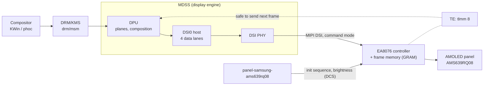
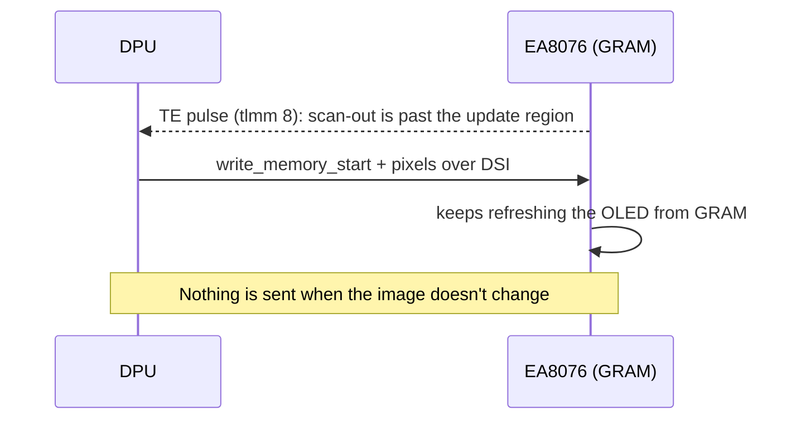

# Display and backlight

**Status:** works, 1080×2340 @ 60 Hz. **Patch:** `kernel/0004-cepheus-ufs-vcc-and-display.patch` (pmaports 0001).
No new driver: the panel is the same module as on raphael (Mi 9T Pro), which mainline already supports.

## Data path



## Command mode, and why simplefb never worked

A command-mode panel has its own frame memory. The SoC sends a frame only when something changed, and the panel keeps
showing it. The bootloader's splash lives in `cont_splash_mem` (`0x9c000000`), and the DT's `simple-framebuffer`
points there, but writing to that memory never reaches the screen because nobody sends it over DSI. You need the real
DRM driver for anything to appear.



## Finding the panel

The bootloader names the panel on the kernel command line: `dsi_samsung_fhd_ea8076_f1mp_cmd_display`. Xiaomi's
downstream panel description (`kernel/downstream-reference/dsi-panel-samsung-fhd-ea8076-f1mp-cmd.dtsi`) has the same
init sequence as mainline's `panel-samsung-ams639rq08` (written for raphael; AMS639RQ08 is the 6.39-inch module, EA8076
its controller). So the work was wiring, not a driver.

## Device tree

```dts
disp_vci_vreg: disp-vci-regulator {          /* panel VCI, switched by tlmm 21 */
    compatible = "regulator-fixed";
    regulator-min-microvolt = <3000000>;
    regulator-max-microvolt = <3000000>;
    gpio = <&tlmm 21 GPIO_ACTIVE_HIGH>;
    enable-active-high;
    regulator-boot-on;
};

&mdss_dsi0 {
    vdda-supply = <&vreg_l3c_1p2>;
    panel: panel@0 {
        compatible = "samsung,ams639rq08";
        vddio-supply = <&vreg_l14a_1p8>;
        vdd3p3-supply = <&disp_vci_vreg>;
        reset-gpios = <&tlmm 6 GPIO_ACTIVE_LOW>;
        pinctrl-0 = <&panel_reset_pin &panel_te_pin>;
    };
};
&mdss_dsi0_out { data-lanes = <0 1 2 3>; };
&mdss_dsi0_phy { vdds-supply = <&vreg_l5a_0p875>; };
```

| Signal | Where | Downstream source |
|---|---|---|
| Reset | tlmm 6, active low | `qcom,mdss-dsi-reset-sequence = <0 1>, <1 10>` |
| TE | tlmm 8, function `mdp_vsync` | `qcom,mdss-dsi-te-pin-select`, `te-using-te-pin` |
| VCI 3.0 V | fixed regulator on tlmm 21 | `disp_vci_vreg` |
| VDDIO 1.8 V | `l14a` | `dsi_amoled_panel_pwr_external_supply` entry 0 |
| Brightness | DCS over DSI, handled by the panel driver | `qcom,mdss-brightness-max-level = <2047>` |

## Check it

```sh
scripts/pm 'cat /sys/class/drm/*DSI*/status /sys/class/drm/*DSI*/modes'
scripts/pm 'ls /sys/class/backlight/ && cat /sys/class/backlight/*/brightness /sys/class/backlight/*/max_brightness'

# Page-flip test. Needs a pty, and -v for continuous flips on a command-mode panel.
# Stop the UI first or modetest can't take the display.
ssh -tt user@172.16.42.1 'sudo modetest -M msm -v -s <connector>:1080x2340'
```

`modetest -M msm -c` lists connector IDs. Without `ssh -tt` it doesn't print its `freq:` lines.

## Open issues

- **Panel polish.** The downstream dtsi has Mi-9-specific `E9` OFC values and `D9`/`C0` command blocks that the generic
  raphael init doesn't send. What exactly they change on this unit hasn't been measured.
- **Rounded corners** clip the console (and the edges of anything drawn into the corners).
- **Variants.** Only panel `f1mp` is tested. Downstream also lists `f1p2` and `f1p2_2`.
- The `simple-framebuffer` node is still in the DT. It's harmless but useless on this panel.
