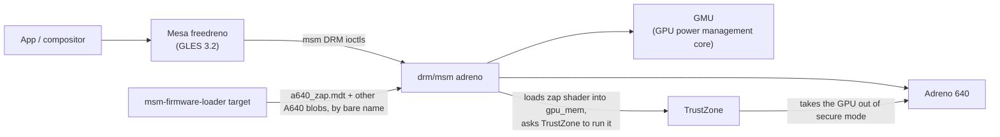

# GPU (Adreno 640)

**Status:** works: freedreno, GLES 3.2, GPU-accelerated browser video. A burst of GPU faults at session start is the top
open issue. **Patch:** `kernel/0006-cepheus-gpu.patch` (pmaports 0003).

## Data path



The **zap shader** is a signed blob that TrustZone loads to take the GPU out of secure mode. Without it the GPU won't
start. Its memory region is `gpu_mem` (`0x98f15000`, 8 KiB, see [hardware](../hardware.md#reserved-memory)).

## Device tree

The SoC DT describes the GPU fully. The board only switches it on and names the zap shader:

```dts
&gmu { status = "okay"; };
&gpu { status = "okay"; };

&gpu_zap_shader {
    /* msm-firmware-loader exposes the vendor blobs flat */
    firmware-name = "a640_zap.mdt";
};
```

## Check it

```sh
scripts/pms 'dmesg | grep -iE "adreno|a6xx|gmu|zap|gpu fault|hangcheck"'
scripts/pm  'ls -l /dev/dri/'
```

## Open issue: fault burst at session start

Right after Plasma starts, `dmesg` shows a burst of `gpu fault` messages and one `hangcheck recover`, then nothing for
the rest of the session.

- Suspect: UBWC (bandwidth compression) or the highest-bank-bit setting for A640 doesn't match what this board's memory
  configuration expects.
- First experiment: `FD_MESA_DEBUG=noubwc` for the session. If the faults disappear, the UBWC configuration
  is the culprit, and the fix belongs in the kernel's A640/SM8150 UBWC parameters.
- It's next on the roadmap ([known issues](../known-issues.md)).
