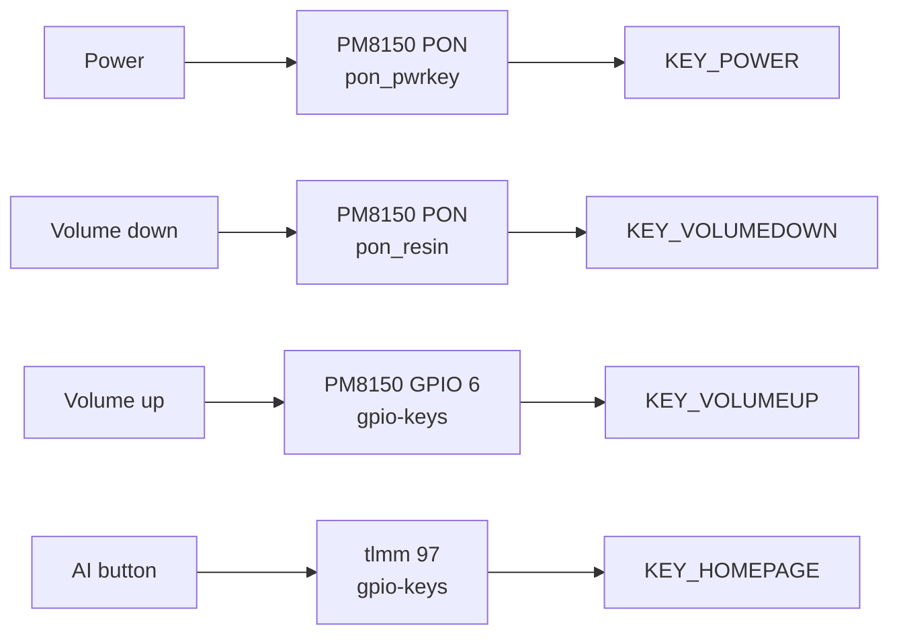
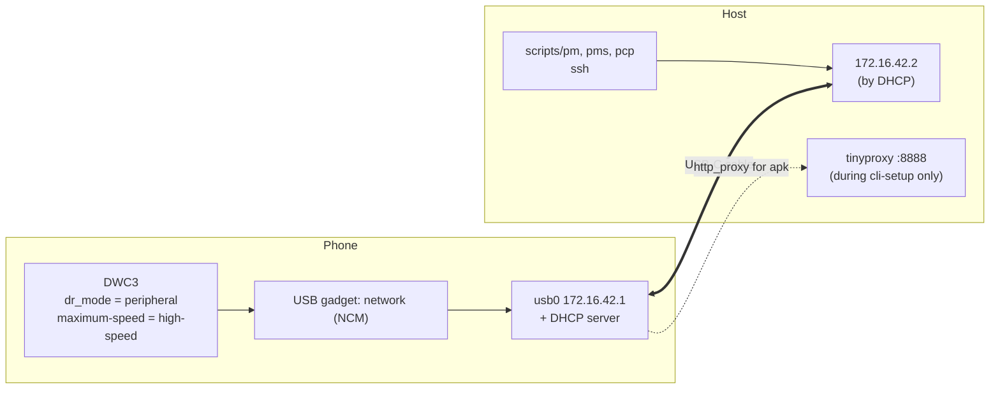

# Buttons and USB

**Status:** works. All of this was already in the cepheus DTS before this project, except where noted.

## Buttons



| Button | Source | Key code | DT notes |
|---|---|---|---|
| Power | PM8150 power-on block (`pon_pwrkey`) | `KEY_POWER` | |
| Volume down | PM8150 RESIN (`pon_resin`) | `KEY_VOLUMEDOWN` | |
| Volume up | PM8150 GPIO 6, pull-up | `KEY_VOLUMEUP` | 15 ms debounce, `wakeup-source` |
| AI | tlmm 97, pull-up | `KEY_HOMEPAGE` (downstream: `KEY_AI`) | 39 ms debounce, `wakeup-source` |

Hardware combos (handled by the PMIC and bootloader, not Linux):

| Combo | Effect |
|---|---|
| Volume Down + Power | Fastboot |
| Power held ~10 s | Forced reset by the PMIC. The way out of emergency mode |

The PON block also stores the reboot reason, so `systemctl reboot --reboot-argument=bootloader` lands in fastboot:

```dts
&pon {
    mode-recovery = <0x1>;
    mode-bootloader = <0x2>;
    mode-rtc = <0x3>;
    mode-normal = <0x20>;
    mode-panic = <0x21>;
};
```

## USB

The USB-C port runs in **peripheral mode, high-speed only** (as downstream). postmarketOS uses it as a network gadget,
which is how you reach the phone at all.



| Address | Who | What runs there |
|---|---|---|
| `172.16.42.1:22` | Phone | sshd (user `user`, placeholder password `cepheus`) |
| `172.16.42.1:23` | Phone, initramfs only | Debug shell (telnet) when boot failed |
| `172.16.42.2` | Host | Gets it via DHCP from the phone |
| `172.16.42.2:8888` | Host | Temporary tinyproxy so a fresh phone can reach the package mirrors |

```dts
&usb_1_dwc3 {
    snps,has-lpm-erratum;
    snps,hird-threshold = /bits/ 8 <0x10>;
    maximum-speed = "high-speed";
    dr_mode = "peripheral";
};
```

PHY supplies: HS PHY `l5a` / `l12a` / `l2a`, QMP PHY `l3c` / `l5a` (see [hardware](../hardware.md#power-rails)).

## Open issues

- No USB host mode (OTG) or USB 3 speeds. Not tried. The vayu OTG patch in the sm8150 package (`0003-xiaomi-vayu-fix-otg.patch`)
  may be a starting point.
- USB-C alternate modes and audio accessory mode aren't described.
