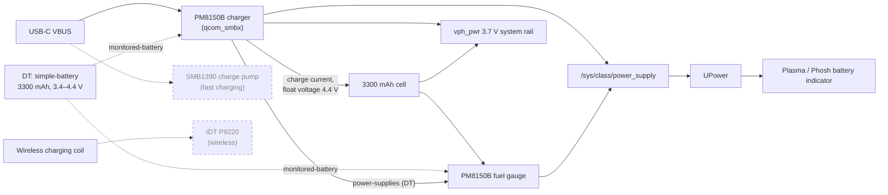

# Battery and charging

**Status:** basic charging and battery reporting work. Fast charging, wireless charging and Xiaomi's fuel-gauge profile
don't. **Patch:** `kernel/0008-cepheus-battery.patch` (pmaports 0005).

The drivers already existed in the sm8150 kernel. The patch describes the battery and switches the PMIC blocks on.

## Architecture



Dashed: on the board, not supported yet.

## Device tree

```dts
/* downstream cepheus-sm8150.dtsi: batterydata-F1-*-3300mah, fv-max-uv 4400000, fg-cutoff-voltage 3400 */
battery: battery {
    compatible = "simple-battery";
    charge-full-design-microamp-hours = <3300000>;
    voltage-min-design-microvolt = <3400000>;
    /* qcom_smbx programs this as the float (max charge) voltage */
    voltage-max-design-microvolt = <4400000>;
};

&pm8150b_charger {
    monitored-battery = <&battery>;
    status = "okay";
};

&pm8150b_fg {
    monitored-battery = <&battery>;
    power-supplies = <&pm8150b_charger>;
    status = "okay";
};
```

> **`voltage-max-design-microvolt` is not just informational.** The charger driver writes it into the float-voltage
> register: it's the voltage the cell is charged to. It must match the cell. 4.4 V is downstream's `fv-max-uv` for this
> phone. Setting it higher overcharges the battery.

## Downstream vs. what we use

| Setting | Downstream | Here |
|---|---|---|
| Float voltage | `fv-max-uv` 4.4 V | 4.4 V (`voltage-max-design-microvolt`) |
| Cutoff | `fg-cutoff-voltage` 3400 mV | 3.4 V (`voltage-min-design-microvolt`) |
| Capacity | ATL / Coslight 3300 mAh profiles | 3300 mAh |
| USB input current | `usb-icl-ua` 2.8 A | not set in DT |
| Fast-charge current | `fcc-max-ua` 4.8 A | not set in DT |
| Fuel-gauge profile | per-cell battery data, ESR calibration | none |
| Thermal mitigation | 16-step current tables | none |

## Check it

```sh
scripts/pm 'for f in /sys/class/power_supply/*/uevent; do echo "== $f"; cat $f; done'
scripts/pm 'upower -d'      # with a UI installed
```

## Open issues

- **Fast charging:** SMB1390 charge pump (on `i2c4`), Quick Charge / USB PD negotiation. Not started.
- **Wireless charging:** IDT P9220 (on `i2c4` @0x3b). No driver.
- **Fuel-gauge profile:** Xiaomi's per-cell battery data isn't loaded. How far the percentage drifts from stock hasn't
  been measured.
- **Battery temperature limits read −30 °C.** Known and considered cosmetic.
