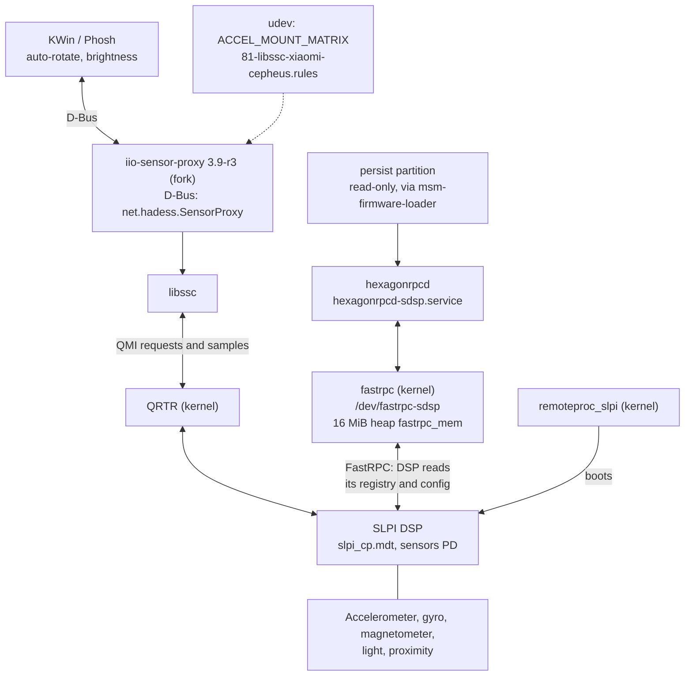
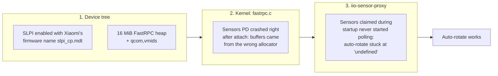
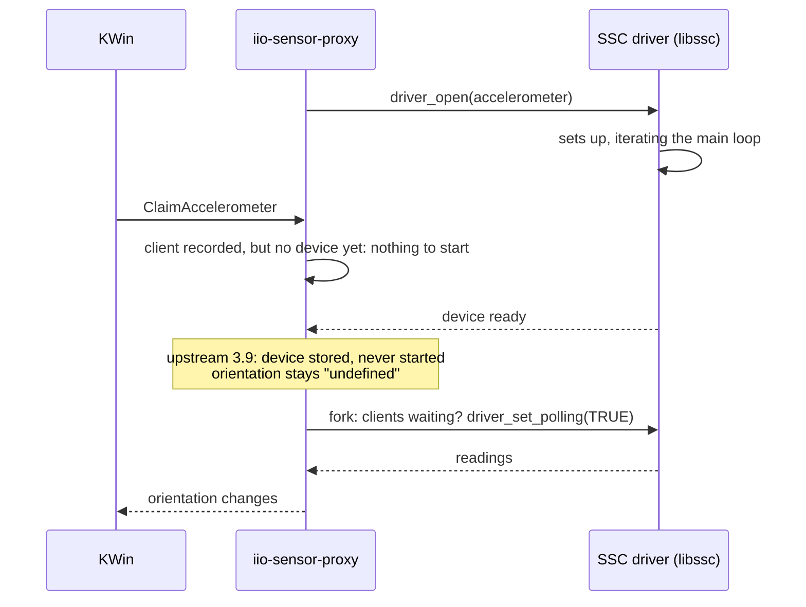

# Sensors and auto-rotate

**Status:** accelerometer, light sensor and compass work, and auto-rotate works in Plasma and Phosh. Proximity isn't
exposed. **Patch:** `kernel/0009-cepheus-slpi-sensors.patch` (pmaports 0006), plus a forked `iio-sensor-proxy` 3.9-r3 and a
mount-matrix udev rule.

This took three separate fixes in three layers.

## Architecture

The sensors aren't wired to Linux at all. They hang off the **SLPI** (Sensor Low Power Island), a Hexagon DSP that
reads them, fuses the data and serves results. Linux talks to it in two directions:

- **Linux → SLPI:** libssc sends QMI requests over QRTR ("give me the accelerometer at 50 Hz").
- **SLPI → Linux:** the DSP firmware calls back into Linux via FastRPC to read files it needs (its sensor registry and
  config live on `persist`). hexagonrpcd answers those calls.



## The three fixes



### 1. Device tree

```dts
reserved-memory {
    /* SLPI FastRPC heap, shared with the DSP via SCM (as on sdm845; downstream adsp_mem) */
    fastrpc_mem: fastrpc {
        compatible = "shared-dma-pool";
        alloc-ranges = <0x0 0x00000000 0x0 0xffffffff>;
        alignment = <0x0 0x400000>;
        size = <0x0 0x1000000>;
        reusable;
    };
};

&remoteproc_slpi {
    firmware-name = "slpi_cp.mdt";   /* downstream qcom,msm-ssc-sensors: "slpi_cp" */
    status = "okay";
    glink-edge {
        fastrpc {
            qcom,vmids = <QCOM_SCM_VMID_HLOS QCOM_SCM_VMID_MSS_MSA
                          QCOM_SCM_VMID_SSC_Q6 QCOM_SCM_VMID_ADSP_Q6>;
            memory-region = <&fastrpc_mem>;
        };
    };
};
```

`qcom,vmids` lists the VMs (Linux, modem, SLPI, ADSP) that the heap gets shared with via TrustZone (SCM), so the DSP is
allowed to access it.

### 2. fastrpc kernel fix

A one-line fix from LKML (Robin Snyders and Piyush Raj Chouhan, reviewed by Dmitry Baryshkov). For the sensors
protection domain, message buffers must come from the shared remote heap, not from the SMMU-mapped allocator:

```c
-	if (ctx->fl->sctx->sid)
+	if (ctx->fl->sctx->sid && ctx->fl->pd != SENSORS_PD)
 		err = fastrpc_buf_alloc(ctx->fl, dev, pkt_size, &ctx->buf);
 	else
 		err = fastrpc_remote_heap_alloc(ctx->fl, dev, pkt_size, &ctx->buf);
```

Without it the sensors PD crashed right after attaching.

### 3. iio-sensor-proxy fork

KWin claims the accelerometer as soon as iio-sensor-proxy appears on D-Bus. The SSC driver's `open()` iterates the
GLib main loop while it sets up, so the claim can arrive **before** the sensor device exists. Upstream 3.9 records
the claim but never starts the sensor once it does exist.



The patch (`pmaports/iio-sensor-proxy-0001-start-sensors-claimed-during-startup.patch`) adds this after storing the
device:

```c
if (g_hash_table_size (data->clients[i]) > 0)
	driver_set_polling (sensor_device, TRUE);
```

The package is `temp/iio-sensor-proxy` in our pmaports, pkgrel **r3**. It must stay above Alpine's r2, or `apk upgrade`
replaces it with the broken one. Drop it once the fix is upstream.

### Mount matrix

The firmware reports an all-zero mount matrix, and on this board the X and Y axes are inverted, so a udev rule sets
the matrix explicitly:

```
# phone-config/etc/udev/rules.d/81-libssc-xiaomi-cepheus.rules
SUBSYSTEM=="misc", KERNEL=="fastrpc-*", ENV{ACCEL_MOUNT_MATRIX}+="-1, 0, 0; 0, -1, 0; 0, 0, 1"
```

## Check it

```sh
scripts/pm  'cat /sys/class/remoteproc/*/name /sys/class/remoteproc/*/state'
scripts/pm  'systemctl status hexagonrpcd-sdsp --no-pager'
scripts/pm  'ls -l /dev/fastrpc-*'
ssh -tt user@172.16.42.1 'monitor-sensor'     # rotate the phone, cover the light sensor
scripts/pm  'apk info -v iio-sensor-proxy'    # must be 3.9-r3
```

## Open issues

- **Proximity** isn't exposed. The hardware is there behind the SLPI. Needs support in libssc / iio-sensor-proxy.
- **SLPI crash = dead sensors until reboot.** remoteproc restarts the DSP, but the userspace side doesn't reconnect.
- The gyroscope and other SSC sensors aren't used by iio-sensor-proxy at all.
