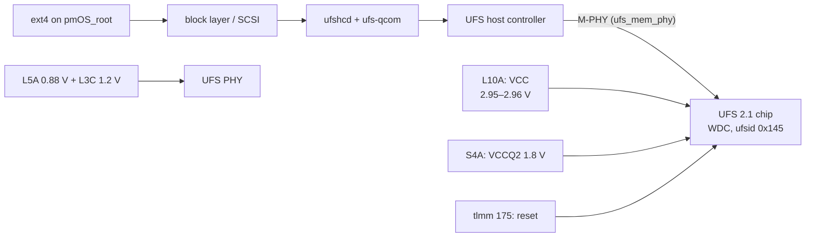
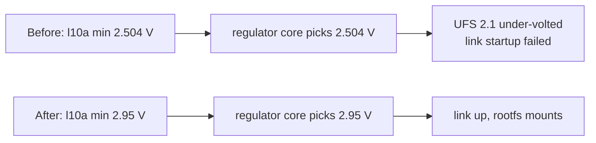

# Storage (UFS)

**Status:** works. **Patch:** `kernel/0004-cepheus-ufs-vcc-and-display.patch` (pmaports 0001).
This was the first blocker: without this fix no cepheus with this UFS chip boots mainline at all.

## Data path



## Device tree

```dts
&ufs_mem_hc {
    reset-gpios = <&tlmm 175 GPIO_ACTIVE_LOW>;
    vcc-supply = <&vreg_l10a_2p5>;     /* schematic: VREG_L10A_2P95 */
    vcc-max-microamp = <750000>;
    vccq2-supply = <&vreg_s4a_1p8>;
    vccq2-max-microamp = <750000>;
};

&ufs_mem_phy {
    vdda-phy-supply = <&vreg_l5a_0p875>;
    vdda-pll-supply = <&vreg_l3c_1p2>;
};

vreg_l10a_2p5: ldo10 {
    regulator-min-microvolt = <2950000>;   /* was 2504000 */
    regulator-max-microvolt = <2960000>;
};
```

## What was wrong

The UFS link never came up: `link startup failed`. The DT allowed VCC (`l10a`) anywhere from 2.504 V to 2.96 V.
The regulator core sets the **lowest** voltage that satisfies every consumer, so the chip got 2.504 V, a UFS 3.0 VCC
level. This phone has UFS **2.1**, which needs about 2.95 V. Downstream uses 2.95 V.



The label `vreg_l10a_2p5` is a leftover name. The value inside is what counts.

## Check it

```sh
scripts/pms 'dmesg | grep -iE "ufs|link startup"'
scripts/pm  'lsblk -o NAME,SIZE,PARTLABEL,MOUNTPOINT'
scripts/pm  'findmnt /'
```

## Open questions

- Other Mi 9 units may have UFS from other vendors. They should also be 2.1 and need the same voltage, but that's
  untested. If one fails with `link startup failed`, check `l10a` first.
- UFS 3.0-capable boards (other SM8150 phones) legitimately use the lower level, so this fix is cepheus-only.
