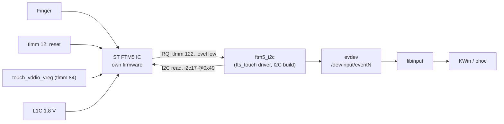
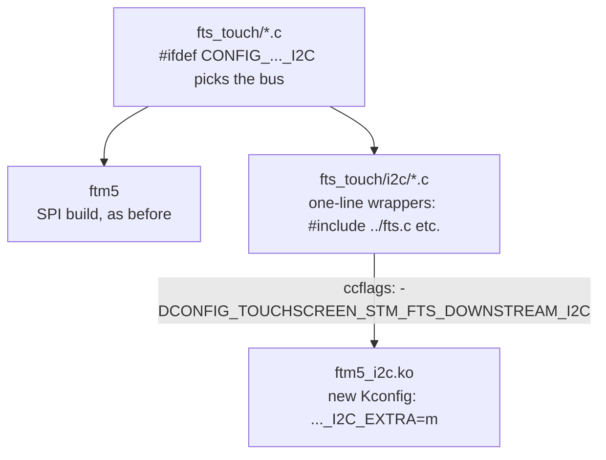
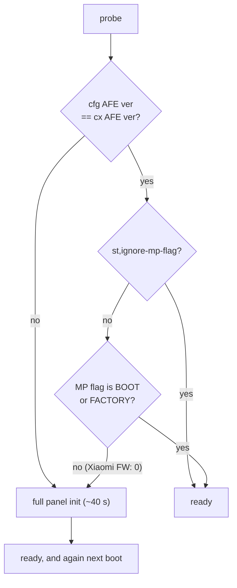

# Touchscreen (ST FTM5)

**Status:** works (multi-touch, full resolution). **Patch:** `kernel/0007-cepheus-touchscreen-ftm5-i2c.patch`
(pmaports 0004, which also sets `CONFIG_TOUCHSCREEN_STM_FTS_DOWNSTREAM_I2C_EXTRA=m`).

## Data path



## The driver problem

The sm8150 kernel fork already carries ST's downstream FTM5 driver (`drivers/input/touchscreen/fts_touch/`), but it
selects the bus at compile time: either SPI (what the Pixel 4 needs, and what the shared kernel config picks) or I2C.
One kernel has to serve both phones.

Patch 0007 builds the same sources a second time as a separate module:



Other changes in the patch:

- `fts_probe(struct i2c_client *)`: the I2C probe signature changed in recent kernels (no more `i2c_device_id`).
- `fts_proc.c`: the SPI-only `SPI_3WIRE` check moved under `#else` so the I2C build compiles.
- **`st,ignore-mp-flag`** (new DT property). On probe, the driver checks the IC's "MP flag" (set at the factory after
  panel calibration). Xiaomi's touch firmware reports flag `0` and refuses to store one. The driver therefore ran a
  **40-second** full panel initialisation on every boot. Xiaomi's AFE versions already match, so the property skips the
  MP-flag condition and keeps the AFE-version check.



## Device tree

```dts
&qupv3_id_2 { status = "okay"; };   /* QUP wrapper that contains i2c17 */

&i2c17 {
    clock-frequency = <400000>;
    touchscreen@49 {
        compatible = "st,fts";
        reg = <0x49>;
        interrupts = <122 IRQ_TYPE_LEVEL_LOW>;
        vdd-supply = <&touch_vddio_vreg>;    /* tlmm 84 */
        avdd-supply = <&vreg_l1c_1p8>;
        st,irq-gpio = <&tlmm 122 GPIO_ACTIVE_HIGH>;
        st,reset-gpio = <&tlmm 12 GPIO_ACTIVE_HIGH>;
        st,max-coords = <1079 2339>;
        st,disable-auto-fw-update;           /* no .ftb on this phone; the IC keeps its own FW */
        st,ignore-mp-flag;
    };
};
```

## Check it

```sh
scripts/pm  'lsmod | grep ftm5'
scripts/pms 'dmesg | grep -iE "fts|ftm5"'
ssh -tt user@172.16.42.1 'sudo evtest'      # pick the fts device, touch the screen
```

## Open issues

- No suspend/wake integration yet.
- The driver also registers gesture keys that nothing uses.
- The downstream driver is large and not upstreamable as-is. Upstream would need either a proper bus split in the driver
  or a mainline FTM5 driver.
