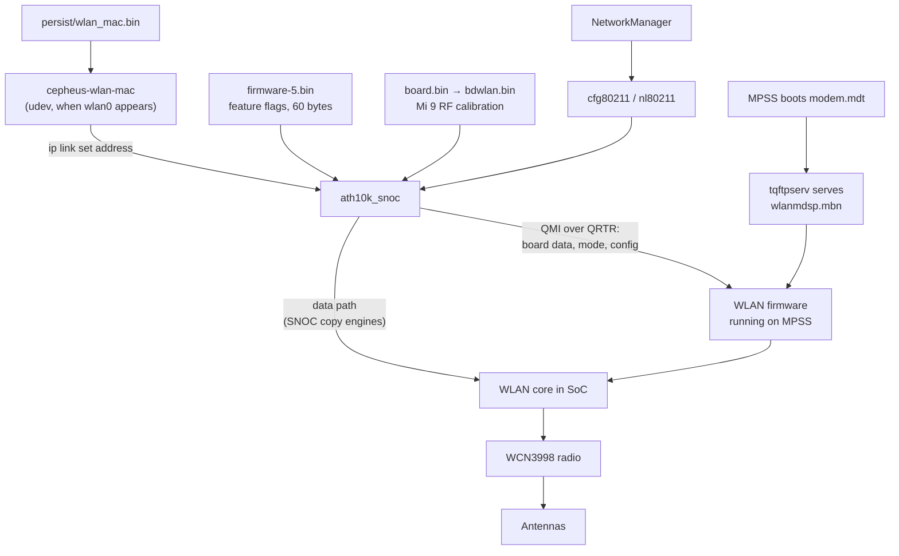
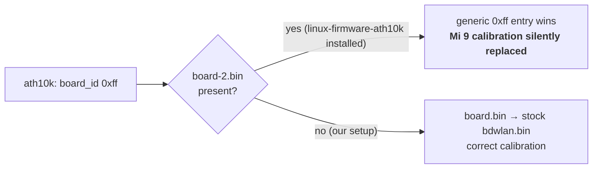
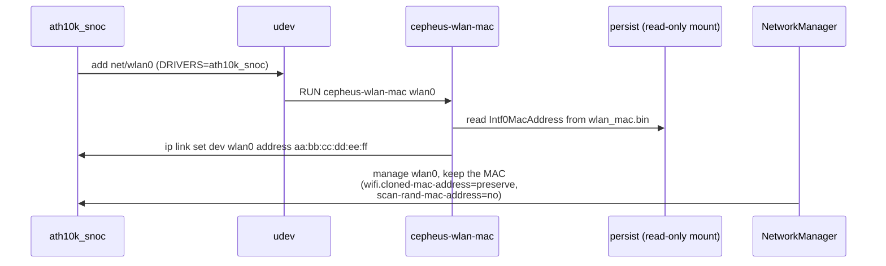

# Wi-Fi (WCN3990 / ath10k)

**Status:** works, with the phone's real MAC. **Patch:** `kernel/0005-cepheus-remoteprocs-wifi.patch` (pmaports 0002),
plus the firmware glue and MAC helper in `phone-config/`.

## Architecture

The Wi-Fi MAC/baseband sits inside the SoC, the radio in the WCN3998 companion chip, and the **firmware runs on the
modem DSP**. ath10k's "WCN3990" naming covers this whole family. So Wi-Fi depends on the modem DSP and its helper
daemons, even with no SIM.



## Board data (calibration)

ath10k needs a board-data file with RF calibration for this exact board. It asks the firmware for a board ID and
gets `0xff`, which is generic. Xiaomi's Android userspace (cnss-daemon) falls back to `bdwlan.bin` in that case, so we
do the same with a symlink:

```
/lib/firmware/ath10k/WCN3990/hw1.0/board.bin  ->  /run/msm-firmware-loader/target/bdwlan.bin
/lib/firmware/ath10k/WCN3990/hw1.0/firmware-5.bin   (copied from linux-firmware: feature flags only)
```



> **Don't install `linux-firmware-ath10k`.** Its `board-2.bin` has an entry for `board_id 0xff` that ath10k prefers
> over `board.bin`.

The proper upstream fix is a `board-2.bin` entry for this board
(`bus=snoc,qmi-board-id=ff,qmi-chip-id=30224,variant=xiaomi_cepheus`), which is why the DT already sets
`qcom,calibration-variant = "xiaomi_cepheus"`.

## MAC address

ath10k picks a random MAC on every boot. The real one is in `persist/wlan_mac.bin` as `Intf0MacAddress=0123456789AB`.



If the file has no valid line, the helper logs it and leaves the driver's MAC alone. `DRY_RUN=1` prints the MAC it
would set.

`bootmac` (needed for Bluetooth) also has a Wi-Fi rule. `device-xiaomi-cepheus` ships a comment-only
`/etc/udev/rules.d/90-bootmac-wifi.rules` with the same name, which masks it, so the real MAC isn't overwritten.

## Device tree

```dts
&remoteproc_mpss {
    firmware-name = "modem.mdt";
    status = "okay";
};

&wifi {
    vdd-0.8-cx-mx-supply = <&vreg_l1a_0p75>;
    vdd-1.8-xo-supply = <&vreg_l7a_1p8>;
    vdd-1.3-rfa-supply = <&vreg_l2c_1p3>;
    vdd-3.3-ch0-supply = <&vreg_l11c_3p3>;
    vdd-3.3-ch1-supply = <&vreg_l10c_3p3>;
    qcom,calibration-variant = "xiaomi_cepheus";
    status = "okay";
};
```

Same supplies as raphael. ADSP and CDSP are enabled in the same patch.

## Files

| File | Installed to | Purpose |
|---|---|---|
| `phone-config/lib/firmware/ath10k/WCN3990/hw1.0/firmware-5.bin` | same path | Firmware feature flags |
| `…/board.bin.SYMLINK_TARGET` | `board.bin` symlink | Points at stock `bdwlan.bin` |
| `phone-config/usr/local/sbin/cepheus-wlan-mac` | same path | Sets the real MAC |
| `phone-config/etc/udev/rules.d/80-cepheus-wlan-mac.rules` | same path | Runs it when `wlan0` appears |
| `phone-config/etc/NetworkManager/conf.d/50-cepheus-wifi-mac.conf` | same path | Stops NM randomising it |
| `90-bootmac-wifi.rules` | device package | Masks bootmac's Wi-Fi rule |

## Check it

```sh
scripts/pms 'dmesg | grep -i ath10k'
scripts/pm  'ip link show wlan0'
scripts/pms 'DRY_RUN=1 /usr/local/sbin/cepheus-wlan-mac wlan0'   # should match the line above
scripts/pm  'nmcli device wifi list'
scripts/pm  'ls -l /lib/firmware/ath10k/WCN3990/hw1.0/'
```

## Gotchas

- **Cold reboot to reset.** Reloading `ath10k_snoc` after the WLAN firmware is up fails, and so does restarting the modem
  by hand.
- A fresh install has no Wi-Fi until `cli-setup.sh` has run, because the firmware glue above isn't there yet. That's why
  the setup script shares the host's internet over USB.
