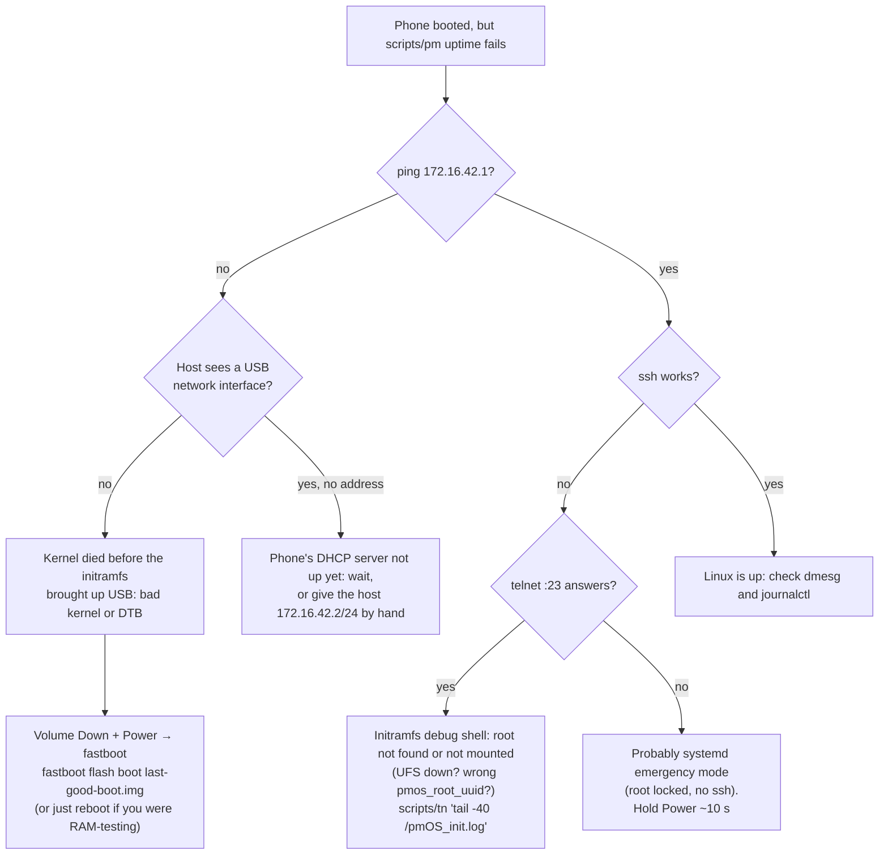

# Troubleshooting and recovery

The bootloader and fastboot are never touched by this project, so **you can always get back to fastboot** with Volume
Down + Power. Everything below starts from that.

- [The phone doesn't come up](#the-phone-doesnt-come-up)
- [Recovery actions](#recovery-actions)
- [Symptoms and causes](#symptoms-and-causes)
- [Useful commands](#useful-commands)

## The phone doesn't come up



## Recovery actions

| Situation | Action |
|---|---|
| A RAM-tested image doesn't boot | Reboot. The flashed `boot` partition is untouched |
| A **flashed** kernel/DTB doesn't boot | Fastboot, `fastboot flash boot <last good boot.img>`. Keep a copy of `/boot/boot.img` before every kernel upgrade |
| Rootfs broken | Reinstall ([README Quick start 2](../README.md#2-install-postmarketos-on-the-phone)), then run a setup script again |
| Emergency mode at boot | Hold Power ~10 s. If it comes back on every boot, the cause is persistent, usually a non-root mount without `nofail`. You can't log in to fix it, so plan on a reinstall. Prevention: `nofail` on every non-root mount |
| IMEI / EFS damaged | `dd` your offline `modemst1/2`, `fsg`, `fsc` dumps back. **Only if actually needed** |
| Wi-Fi or a DSP stuck after messing with modules | Cold reboot (power off, then on). Hot reloads don't recover |

Before an upgrade:

```sh
scripts/pcp phone:/boot/boot.img images/boot-known-good.img
```

## Symptoms and causes

| Symptom | Likely cause | Fix / check | More |
|---|---|---|---|
| `link startup failed`, no rootfs | UFS VCC too low | `l10a` minimum must be 2.95 V | [storage](subsystems/storage.md) |
| Black screen, but ssh works | Panel not probed, or the UI didn't start | `dmesg \| grep -iE "dsi\|panel"`, `systemctl status plasma-mobile` or `greetd` | [display](subsystems/display.md) |
| Bootloader splash stays forever | Probably DRM never took over the command-mode panel, which keeps showing its last frame | Same as above. simplefb can't update this panel | [display](subsystems/display.md) |
| Burst of `gpu fault` + one `hangcheck recover` at session start | Known issue | Try `FD_MESA_DEBUG=noubwc` | [gpu](subsystems/gpu.md) |
| Touch takes ~40 s to respond after boot | `st,ignore-mp-flag` missing from the DT | Check the DTB you booted | [touch](subsystems/touch.md) |
| No `wlan0` | MPSS not running, or tqftpserv/rmtfs missing | Remoteproc states, `systemctl status tqftpserv rmtfs` | [wifi](subsystems/wifi.md) |
| Wi-Fi misbehaves after installing more firmware | `linux-firmware-ath10k` installed: `board-2.bin` overrides the Mi 9 calibration | `apk del linux-firmware-ath10k`, cold reboot | [wifi](subsystems/wifi.md#board-data-calibration) |
| Random Wi-Fi MAC each boot | `cepheus-wlan-mac` didn't run, or NM randomises | `DRY_RUN=1 /usr/local/sbin/cepheus-wlan-mac wlan0`, check `50-cepheus-wifi-mac.conf` | [wifi](subsystems/wifi.md#mac-address) |
| Wi-Fi MAC looks generated, not the real one | bootmac's Wi-Fi rule ran | `90-bootmac-wifi.rules` present? (device package ≥ 7-r1) | [bluetooth](subsystems/bluetooth.md#bd-address) |
| Bluetooth adapter missing or has no address | `hci_qca` firmware not found, or bootmac didn't run | `dmesg \| grep -i qca`, `bluetoothctl show` | [bluetooth](subsystems/bluetooth.md) |
| No sound | UCM not installed, or card name changed | `aplay -l`, check the `conf.d/sm8150/Xiaomi Mi 9.conf` file | [audio](subsystems/audio.md) |
| Auto-rotate stuck "undefined" | Alpine's iio-sensor-proxy replaced our r3 | `apk info -v iio-sensor-proxy` must show 3.9-r3 | [sensors](subsystems/sensors.md#3-iio-sensor-proxy-fork) |
| Rotation goes the wrong way | Mount matrix rule missing | `81-libssc-xiaomi-cepheus.rules` | [sensors](subsystems/sensors.md#mount-matrix) |
| Sensors died mid-session | SLPI crashed | Reboot. Userspace doesn't reconnect | [sensors](subsystems/sensors.md) |
| `apk` fails with TLS errors on a fresh phone | Clock is wrong (RTC read-only) | `cli-setup.sh` sets it from the host. Or `date -s` by hand | [phone-setup](phone-setup.md) |
| `apk` can't reach mirrors on a fresh phone | No Wi-Fi yet | Run `cli-setup.sh` (USB proxy), install `tinyproxy` on the host | [phone-setup](phone-setup.md#internet-for-a-fresh-phone) |
| Test DTB "disappeared" after a reboot | An `apk add` ran mkinitfs, which re-flashed `boot` from the installed kernel | Re-run `scripts/test-dtb.sh` | [boot](boot-and-storage.md#kernel-upgrades-write-boot-automatically) |
| `insmod` fails with `BTF: -22` | Module built against a newer tree than the running kernel | `llvm-objcopy --remove-section=.BTF` | [development](development.md#testing-a-single-module) |
| `modetest` prints no `freq:` lines | No pty | `ssh -tt`, and `-v` for continuous flips | [display](subsystems/display.md#check-it) |
| Background job dies when ssh closes | Expected: it belongs to the ssh session | `systemd-run --unit=x --collect sh -c '…'` | [development](development.md#conventions) |
| ssh host key warning after reflash | Host key changes on every install | The scripts don't pin it. For plain ssh, remove the old key | |

## Useful commands

```sh
# Overall health
scripts/pm  'uname -a; uptime; systemctl --failed --no-pager'
scripts/pms 'dmesg --level=err,warn | tail -50'

# DSPs
scripts/pm  'for r in /sys/class/remoteproc/*; do echo "$(cat $r/name) $(cat $r/state)"; done'

# Firmware
scripts/pm  'ls /run/msm-firmware-loader/target | wc -l'

# Logs from the previous boot (if journald keeps them persistently)
scripts/pms 'journalctl -b -1 -p warning --no-pager | tail -50'

# Kernel log from a crashed boot, if pstore caught it (ramoops region is in the DT)
scripts/pms 'ls /sys/fs/pstore/ && cat /sys/fs/pstore/*'

# Initramfs debug shell (only when boot failed there)
T=6 scripts/tn 'tail -40 /pmOS_init.log'

# Reboot into fastboot from Linux
scripts/pms 'systemctl reboot --reboot-argument=bootloader'
```
